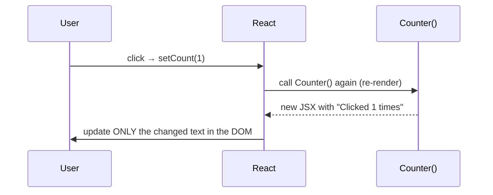

# 3. React fundamentals

<div class="learn">

**What you'll learn**
- What a component is and how JSX compares with Razor
- Props (inputs), state (memory) and events
- Rendering lists and conditional content
- Effects, refs and custom hooks, with the rules that keep them working

<p class="meta">⏱ 60 minutes · Examples come from <code>frontend/src/components</code></p>
</div>

## Components = functions that return UI

A React **component** is a function whose name starts with a capital letter and which returns **JSX**, an HTML-like syntax inside TypeScript.

```tsx
// src/components/ui/Spinner.tsx (simplified)
export function PageSpinner({ label = "Loading..." }: { label?: string }) {
  return (
    <div className="flex items-center gap-3 py-16 text-slate-500" role="status">
      <Spinner />
      <span>{label}</span>
    </div>
  );
}
```

Use it like an HTML tag: `<PageSpinner label="Loading employees..." />`.

<DotnetVsReact dotnetTitle="Razor (.cshtml)" reactTitle="JSX (.tsx)">
<template #dotnet>

```razor
@model EmployeeDto
<div class="card">
  <h2>@Model.FullName</h2>
  @if (Model.IsActive) {
    <span class="badge">Active</span>
  }
  <ul>
  @foreach (var e in Model.Skills) {
    <li>@e</li>
  }
  </ul>
</div>
```

</template>
<template #react>

```tsx
function EmployeeCard({ employee }: { employee: Employee }) {
  return (
    <div className="card">
      <h2>{employee.fullName}</h2>
      {employee.isActive && <span className="badge">Active</span>}
      <ul>
        {employee.skills.map((s) => (
          <li key={s}>{s}</li>
        ))}
      </ul>
    </div>
  );
}
```

</template>
</DotnetVsReact>

### JSX rules you'll hit on day one

| Rule | Example |
| --- | --- |
| `{ }` switches from markup to an expression | `<h2>{employee.fullName}</h2>` |
| `className` instead of `class`, `htmlFor` instead of `for` | `<label htmlFor="email">` |
| Attributes are camelCase | `onClick`, `tabIndex`, `aria-label` stays as-is |
| One root element, or a Fragment `<>…</>` | `return <><Header /><Table /></>` |
| Every tag must close | `<input />`, `<br />` |
| Inline styles are objects | <code v-pre>style={{ width: "50%" }}</code> |
| Comments | `{/* like this */}` |

## Props: a component's parameters

Props flow **down** from parent to child, and the child must not change them.

```tsx
// src/components/ui/Feedback.tsx
export function PageHeader({ title, description, actions }: {
  title: string;
  description?: string;          // optional
  actions?: React.ReactNode;     // any JSX
}) {
  return (
    <div className="mb-6 flex justify-between">
      <div>
        <h1 className="text-2xl font-bold">{title}</h1>
        {description && <p className="text-sm text-slate-500">{description}</p>}
      </div>
      {actions && <div className="flex gap-2">{actions}</div>}
    </div>
  );
}

// usage: passing JSX as a prop
<PageHeader title="Employees" actions={<LinkButton href="/employees/new">+ Add</LinkButton>} />
```

`children` is a special prop: whatever you put *between* the tags.

```tsx
<Card className="p-6">
  <p>This paragraph is Card's children</p>
</Card>
```

::: info 🟣 Coming from .NET
Props ≈ the parameters of a View Component's `InvokeAsync(...)`, or a partial view's model. `children` ≈ `@RenderBody()` / `@RenderSection()`.
:::

## State: a component's memory

`useState` gives a component a value that **survives re-renders**, and a setter that **triggers a re-render**.

```tsx
"use client";
import { useState } from "react";

function Counter() {
  const [count, setCount] = useState(0);   // [current value, setter]

  return <button onClick={() => setCount(count + 1)}>Clicked {count} times</button>;
}
```

What happens on click:



::: info 🟣 Coming from .NET
Think of the component function as a **view that re-executes whenever its data changes**. In MVC the server re-renders a whole page after a POST; React re-runs one function in the browser and patches only the differences in the DOM.
:::

::: warning Never mutate state
```tsx
const [employee, setEmployee] = useState(initial);
employee.salary = 1000;               // ❌ React doesn't notice
setEmployee({ ...employee, salary: 1000 }); // ✅ new object → re-render
```
:::

A real example from the demo, the confirm-delete flow in `EmployeesView.tsx`:

```tsx
const [toDelete, setToDelete] = useState<Employee | null>(null);
// …
<EmployeeTable employees={data.items} onDelete={setToDelete} />   {/* child calls setToDelete(employee) */}
<ConfirmDialog
  open={toDelete !== null}
  message={<>Delete <b>{toDelete?.fullName}</b>?</>}
  onConfirm={confirmDelete}
  onCancel={() => setToDelete(null)}
/>
```

This is **lifting state up**: the parent owns the state, and children receive the value and callbacks to change it.

## Events

```tsx
<button onClick={() => setOpen(true)}>Delete</button>

<input value={username} onChange={(e) => setUsername(e.target.value)} />

<form onSubmit={(e) => {
  e.preventDefault();        // stop the browser's full-page POST
  save();
}}>
```

## Rendering lists: the `key` prop

```tsx
{employees.map((e) => (
  <tr key={e.id}>       {/* stable, unique id, NOT the array index */}
    <td>{e.fullName}</td>
  </tr>
))}
```

React uses `key` to match rows between renders (like a primary key). Missing keys give a console warning and subtle bugs.

## Conditional rendering

```tsx
// src/components/employees/EmployeesView.tsx
{isPending ? (
  <PageSpinner label="Loading employees..." />
) : isError ? (
  <ErrorAlert message={error.message} />
) : data.items.length === 0 ? (
  <EmptyState title="No employees found" />
) : (
  <EmployeeTable employees={data.items} ... />
)}
```

Or early returns, which are often clearer:

```tsx
// src/components/employees/EmployeeDetails.tsx
if (isPending) return <PageSpinner />;
if (error) return <ErrorAlert message={error.message} />;
return <Card>…</Card>;
```

## Hooks

Functions starting with `use` are **hooks**. They let components "hook into" React features.

| Hook | Purpose | Demo file |
| --- | --- | --- |
| `useState` | local state | `LoginForm.tsx` |
| `useEffect` | run side effects after render (subscriptions, timers) | `ConfirmDialog.tsx` |
| `useRef` | mutable box that doesn't trigger re-render | `useDebouncedCallback.ts` |
| `useMemo` / `useCallback` | cache a computed value / function between renders | `AuthContext.tsx` |
| `useContext` | read shared data from a Provider | `AuthContext.tsx` |
| `useId` | unique ids for `<label htmlFor>` | `EmployeeForm.tsx` |
| `useTransition` / `useActionState` | pending state for async actions | `DeleteDepartmentButton.tsx`, `DepartmentForm.tsx` |
| `useSyncExternalStore` | subscribe to data outside React (cookies) | `AuthContext.tsx` |

::: danger The Rules of Hooks
1. Call hooks **only at the top level** of a component or custom hook, never inside `if`, loops or callbacks.
2. Call them **only from components or other hooks**.

React identifies each hook by its *call order*. An `if` around a hook changes the order and breaks state. ESLint (`react-hooks` rules) checks this for you.
:::

### `useEffect`: synchronising with the outside world

```tsx
// src/components/ui/ConfirmDialog.tsx
useEffect(() => {
  if (!open) return;
  const onKey = (e: KeyboardEvent) => e.key === "Escape" && onCancel();
  window.addEventListener("keydown", onKey);              // subscribe
  return () => window.removeEventListener("keydown", onKey); // cleanup (≈ Dispose)
}, [open, onCancel]);  // dependency array: re-run when these change
```

::: tip You probably don't need an effect
Effects are for syncing with **external systems** (DOM events, timers, sockets). Don't use them to compute values from props/state (just compute during render) or to respond to a button click (do it in the click handler). This demo deliberately reacts to a Server Action's result *inside the action* rather than in an effect (see `DepartmentForm.tsx`).
:::

### Custom hooks: reusable logic

A custom hook is just a function that calls other hooks. The demo has several:

```tsx
// src/hooks/useEmployees.ts
export function useEmployee(id: number) {
  return useQuery({
    queryKey: employeeKeys.detail(id),
    queryFn: ({ signal }) => employeesApi.get(id, signal),
  });
}

// any component:
const { data: employee, isPending, error } = useEmployee(42);
```

::: info 🟣 Coming from .NET
A custom hook is like an injected service *with UI-aware state*. Instead of `IEmployeeService` injected through the constructor, you call `useEmployee(id)` and get `data`, `isPending` and `error` back, and the component re-renders when they change.
:::

## Composition over inheritance

React has no component inheritance. You build big components from small ones:

```
EmployeesView
├── EmployeeFilters   (search box, dropdowns)
├── Card
│   ├── EmployeeTable (rows, sort headers)
│   └── Pagination
└── ConfirmDialog
```

Each piece is small and focused, and you can test it on its own: the **Single Responsibility Principle** applied to UI.

## Recap

- A component is a function `props → JSX`, re-run whenever its state or props change.
- **Props** go down, **events/callbacks** go up, **state** lives in the lowest common parent.
- Lists need a stable `key`; never mutate state.
- Hooks must be called unconditionally at the top level.

## Try it yourself

Add a "Showing X active" counter above the employee table in `EmployeesView.tsx`.

::: details Solution
Derive it during render, so no new state is needed:
```tsx
const activeCount = data?.items.filter((e) => e.isActive).length ?? 0;
// in the JSX:
<p className="text-sm text-slate-500">{activeCount} active on this page</p>
```
:::

[Next: Create a Next.js project from zero →](./04-create-nextjs-project-from-zero)
