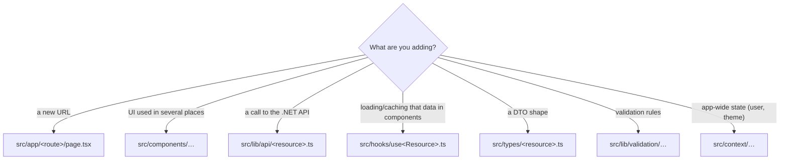

# 5. Project structure & every file

<div class="learn">

**What you'll learn**
- What every file generated by `create-next-app` does, and whether you should edit it
- The file types you'll meet (`.ts`, `.tsx`, `.mjs`, `.d.ts`, `.env*`, …)
- How this repo's `frontend/` folder is organised

<p class="meta">⏱ 30 minutes · Open <code>frontend/</code> in VS Code next to this page</p>
</div>

## The generated project

Click any underlined file to jump to its explanation.

<FileTree name="generated" title="What create-next-app generates" />

## File types

| Extension | What it contains | Notes |
| --- | --- | --- |
| `.tsx` | TypeScript **with JSX** (components) | Any file that returns `<div>…</div>` |
| `.ts` | TypeScript without JSX | API client, helpers, hooks, types, config |
| `.js` / `.jsx` | plain JavaScript | You'll see them in libraries and older projects |
| `.mjs` / `.cjs` | JavaScript explicitly as **ES module** / **CommonJS** | `eslint.config.mjs` uses `import/export` syntax |
| `.mts` | TypeScript as ES module | `docs/.vitepress/config.mts` |
| `.d.ts` | **type declarations only**, no code | Like a reference assembly / interface file. `next-env.d.ts` |
| `.css` | stylesheets | `globals.css` imports Tailwind |
| `.json` | configuration / data | `package.json`, `tsconfig.json` |
| `.env`, `.env.local`, `.env.development`, `.env.production` | environment variables | Like `appsettings.{Env}.json`, but `KEY=value` lines (chapter 9) |
| `.md` / `.mdx` | Markdown docs | MDX = Markdown with components |
| `.ico`, `.svg`, `.png` | assets | in `public/` or `app/` (favicon) |

::: info 🟣 Coming from .NET
There is no compiled DLL. The build turns `.ts/.tsx` into optimized `.js` bundles in `.next/`, just as `dotnet build` turns `.cs` into `.dll` files in `bin/`.
:::

## Root files, one by one

### `package.json` {#package-json}

The project manifest: name, version, **scripts**, **dependencies**. It's the `.csproj` of a JS project. Full tour in [chapter 6](./06-package-management).

```json
{
  "name": "employee-demo-web",
  "version": "1.0.0",
  "private": true,
  "scripts": {
    "dev": "next dev",
    "build": "next build",
    "start": "next start",
    "lint": "eslint",
    "typecheck": "tsc --noEmit"
  },
  "dependencies": { "next": "16.4.5", "react": "19.3.0", "...": "..." },
  "devDependencies": { "typescript": "^5", "...": "..." }
}
```

✏️ **Edit:** yes, but add packages with `npm install` rather than by hand.

### `package-lock.json` {#package-lock-json}

The exact version of **every** package (including dependencies of dependencies) that was installed. Guarantees everyone and the CI get identical `node_modules`.
✏️ **Edit:** never by hand. ✅ **Commit:** always.

### `tsconfig.json` {#tsconfig-json}

TypeScript compiler options: the `<PropertyGroup>` of your project.

```json
{
  "compilerOptions": {
    "target": "ES2017",          // JS version to emit (Next re-compiles anyway)
    "lib": ["dom", "dom.iterable", "esnext"], // APIs available: browser DOM + modern JS
    "strict": true,              // like <Nullable>enable</Nullable> + warnings as errors
    "noEmit": true,              // tsc only CHECKS; Next.js (Turbopack) does the compiling
    "module": "esnext",
    "moduleResolution": "bundler",
    "jsx": "react-jsx",
    "paths": { "@/*": ["./src/*"] } // the "@/" import alias
  },
  "include": ["next-env.d.ts", "**/*.ts", "**/*.tsx", ".next/types/**/*.ts"]
}
```

✏️ **Edit:** rarely. Keep `strict: true`.

### `next.config.ts` {#next-config-ts}

Framework settings, read by `next dev` and `next build`. This repo's version:

```ts
const nextConfig: NextConfig = {
  output: "standalone",          // self-contained server folder for deployment (ch. 16)
  cacheComponents: true,         // Next 16 default: fresh data unless "use cache"
  partialPrefetching: true,
  env: { NEXT_PUBLIC_APP_VERSION: process.env.APP_VERSION ?? packageJson.version },
  turbopack: { rules: { "*.css": { loaders: ["@tailwindcss/turbopack"], as: "*.css" } } },
};
```

Other common options: `images` (allowed remote image hosts), `redirects`, `rewrites`, `headers`, `basePath` (host under a sub-path like an IIS virtual directory).

### `eslint.config.mjs` {#eslint-config-mjs}

Linting rules. Uses Next.js' recommended sets (`core-web-vitals`, `typescript`), which include the **Rules of Hooks**. Run with `npm run lint`.

### `next-env.d.ts`

Generated type declarations so TypeScript understands Next.js types. ✏️ **Edit:** never. It's git-ignored and regenerated.

### `.gitignore`

Keeps `node_modules/`, `.next/`, `*.tsbuildinfo`, `.env*.local` out of git. This repo additionally allows committing `.env.example`, `.env.development` and `.env.production`, which contain **no secrets**.

### `AGENTS.md`

Instructions for AI coding assistants, written and re-added by `next dev`. Safe to keep or ignore.

## Folders

### `src/app/`: the router

Every folder is a URL segment; special file names have special meanings. Full details in [chapter 7](./07-routing-and-rendering).

#### `layout.tsx` {#layout-tsx}

Wraps all pages, like `_Layout.cshtml`. The root layout **must** render `<html>` and `<body>`.

```tsx
// src/app/layout.tsx (simplified)
export const metadata: Metadata = {
  title: { default: "Employee Demo", template: "%s · Employee Demo" },
};

export default function RootLayout({ children }: LayoutProps<"/">) {
  return (
    <html lang="en">
      <body className="flex min-h-full flex-col bg-slate-50">
        <Providers>
          <Navbar />
          <main className="mx-auto max-w-6xl px-4 py-8">{children}</main>   {/* = @RenderBody() */}
        </Providers>
      </body>
    </html>
  );
}
```

`metadata` generates `<title>` and `<meta>` tags. Pages can export their own `metadata` to override the title (`"Employees · Employee Demo"`).

#### `page.tsx` {#page-tsx}

The UI for one URL. `src/app/page.tsx` = `/`, `src/app/employees/page.tsx` = `/employees`. **Must** `export default` a component.

#### `globals.css`

Global styles. In Tailwind v4 it's one line, `@import "tailwindcss";`, plus optional theme tokens.

#### `favicon.ico`

Served automatically as the browser tab icon.

### `public/` {#public}

Static files served from the site root without processing: `public/logo.png` → `http://localhost:3000/logo.png`. Same as `wwwroot/` in ASP.NET Core.

### `node_modules/` {#node-modules}

Installed packages (often 300+ folders, ~400 MB). Recreated by `npm install` / `npm ci`. **Never commit, never edit.** Delete it freely when something is weird and reinstall.

### `.next/` {#next-folder}

Build output and dev cache (like `bin/` + `obj/`). Delete it to force a clean build.

| Sub-folder | Contents |
| --- | --- |
| `.next/dev/` | output of `next dev` |
| `.next/server/` | compiled server code (Server Components, route handlers) |
| `.next/static/` | hashed JS/CSS chunks for the browser |
| `.next/standalone/` | deployable server (only with `output: "standalone"`) |
| `.next/types/` | generated route types (`PageProps<"/employees/[id]">`) |

## This repo's `frontend/` folder

<FileTree name="frontend" title="frontend/ (finished demo)" />

### Where does new code go?



::: tip Naming conventions used here
- Components: `PascalCase.tsx` (`EmployeeTable.tsx`), one main component per file.
- Hooks: `useSomething.ts`.
- Route folders: lowercase URL words (`employees`, `[id]`, `edit`).
- Next.js special files are lowercase and fixed: `page.tsx`, `layout.tsx`, `loading.tsx`, `error.tsx`, `not-found.tsx`.
:::

## Recap

- `package.json` ≈ `.csproj`, `package-lock.json` ≈ lock file, `tsconfig.json` ≈ compiler settings, `next.config.ts` ≈ framework options.
- `node_modules/` and `.next/` are generated; never commit or edit them.
- `src/app/` is the router; everything else is organised by convention.

## Try it yourself

Find which file sets the browser tab title "Employees · Employee Demo" on `/employees`.

::: details Answer
Two files cooperate: `src/app/layout.tsx` defines the template `"%s · Employee Demo"`, and `src/app/employees/page.tsx` exports `metadata = { title: "Employees" }`.
:::

[Next: npm & package.json →](./06-package-management)
