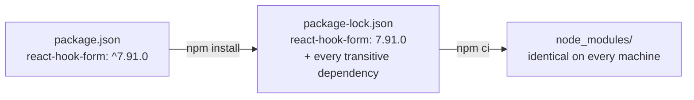

# 6. npm & package.json

<div class="learn">

**What you'll learn**
- How npm compares with NuGet, and `package.json` with `.csproj`
- `dependencies` vs `devDependencies`, semantic version ranges, the lock file
- The commands you'll use: `install`, `ci`, `run`, `npx`, `outdated`, `audit`
- How to read (and not panic about) `npm audit`

<p class="meta">⏱ 25 minutes</p>
</div>

## npm vs NuGet

| Task | .NET | npm |
| --- | --- | --- |
| Manifest | `MyApp.csproj` | `package.json` |
| Add a package | `dotnet add package Zod` | `npm install zod` (alias `npm i zod`) |
| Add a dev-only tool | `PrivateAssets="all"` / a local tool | `npm install -D typescript` |
| Remove | `dotnet remove package X` | `npm uninstall x` |
| Restore | `dotnet restore` | `npm install` (dev) / **`npm ci`** (CI & release) |
| Lock file | `packages.lock.json` (opt-in) | `package-lock.json` (always) |
| Where packages go | global cache `~/.nuget/packages` | **per project** `node_modules/` |
| Run a tool once | `dotnet tool run` | `npx <tool>` |
| Custom commands | MSBuild targets | `"scripts"` in package.json |
| Registry | nuget.org | npmjs.com |

## Anatomy of `package.json`

```json
{
  "name": "employee-demo-web",       // package name (lowercase)
  "version": "1.0.0",                // YOUR app's version, shown in the footer
  "private": true,                   // prevents accidental `npm publish`
  "scripts": {                       // npm run <name>
    "dev": "next dev",
    "build": "next build",
    "start": "next start",
    "lint": "eslint",
    "typecheck": "tsc --noEmit"
  },
  "dependencies": {                  // needed at RUNTIME (shipped)
    "@hookform/resolvers": "^7.0.3",
    "@tanstack/react-query": "^5.107.1",
    "next": "16.4.5",
    "react": "19.3.0",
    "react-dom": "19.3.0",
    "react-hook-form": "^7.91.0",
    "sonner": "^2.0.8",
    "zod": "^4.6.7"
  },
  "devDependencies": {               // needed only to BUILD / develop
    "@tailwindcss/turbopack": "^4",
    "@tanstack/react-query-devtools": "^5.107.1",
    "@types/node": "^20",
    "@types/react": "^19",
    "@types/react-dom": "^19",
    "eslint": "^9",
    "eslint-config-next": "16.4.5",
    "tailwindcss": "^4",
    "typescript": "^5"
  }
}
```

::: tip `@types/...` packages
Libraries written in plain JavaScript ship their TypeScript types separately as `@types/<name>`. They're only needed at build time → `devDependencies`.
:::

::: info 🟣 Coming from .NET
In a Next.js app the distinction is softer than in a library: `next build` bundles what your code imports, whichever list it's in. Still, keep build tools (TypeScript, ESLint, Tailwind) in `devDependencies`. It documents intent, and some deploy setups install only `dependencies`.
:::

## Version ranges (semver)

`MAJOR.MINOR.PATCH`: breaking . features . fixes.

| Range | Allows | Example match for `^5.107.1` / `~5.107.1` |
| --- | --- | --- |
| `16.4.5` | exactly this | `16.4.5` only |
| `^5.107.1` | same **major** (default for `npm install`) | `5.108.0` ✅, `6.0.0` ❌ |
| `~5.107.1` | same **minor** | `5.107.9` ✅, `5.108.0` ❌ |
| `^5` | any 5.x | `5.9.3` |
| `*` / `latest` | anything (avoid) | |

The range in `package.json` says what's *allowed*; `package-lock.json` records what was *actually installed*.

## The lock file {#package-lock-json}



| Command | When | Behaviour |
| --- | --- | --- |
| `npm install` | daily development, after `git pull` | installs, may **update the lock file** within ranges |
| `npm ci` | **CI servers and release builds** | deletes `node_modules`, installs **exactly** the lock file, fails if it doesn't match `package.json` |

`scripts/build-frontend.ps1` uses `npm ci` so every release is reproducible.

## Everyday commands

```powershell
npm install                     # restore everything
npm install zod                 # add a runtime dependency
npm install -D prettier         # add a dev dependency
npm install zod@4.6.7           # specific version
npm uninstall sonner            # remove
npm run build                   # run a script ("run" is optional for start/test)
npx next --help                 # run a package's CLI without a script
npm ls react                    # who depends on react? (= dependency tree)
npm outdated                    # what has newer versions?
npm update                      # update within the ranges (minor/patch)
npm install next@latest         # deliberate major upgrade
```

## Security: `npm audit`

After installing, npm may say:

```txt
8 moderate severity vulnerabilities
To address all issues (including breaking changes), run: npm audit fix --force
```

Read the report (`npm audit`) before acting. In this demo, at the time of writing, all findings were in **ESLint's dependencies** (`minimatch` via `typescript-eslint`), a **dev-only tool** that never runs in production. `npm audit fix --force` would have *downgraded* `eslint-config-next` to an older major version: worse, not better.

::: warning Rules of thumb
- Never run `npm audit fix --force` blindly. It may install breaking major versions.
- Prioritise vulnerabilities in **`dependencies`** (shipped code) over dev tooling.
- `npm audit --omit=dev` shows only what ships to production.
- The .NET equivalent check is `dotnet list package --vulnerable --include-transitive`, which in this repo found and fixed a vulnerable transitive `System.Security.Cryptography.Pkcs` by pinning a newer version in the `.csproj`.
:::

## Install scripts (npm 11+)

Some packages run a script after install (e.g. `esbuild` downloads a native binary). Recent npm versions may hold them back and print:

```txt
npm warn install-scripts   esbuild@0.21.5 (postinstall: node install.js)
Run `npm install-scripts ls` to review, or `npm install-scripts approve <pkg>` to allow.
```

This is a supply-chain safety feature. Approve only packages you trust and need (`npm install-scripts approve esbuild`). In this repo everything works without approving, because esbuild's binary also ships as an optional dependency.

## Recap

- `package.json` = what you want, `package-lock.json` = what you got. Commit both.
- `npm install` while developing, `npm ci` for builds and CI.
- `dependencies` ship; `devDependencies` are tools.
- Read `npm audit` output; don't `--force` it.

## Try it yourself

Find out which version of `zod` is installed and why it's there.

::: details Solution
```powershell
npm ls zod
# employee-demo-web@1.0.0
# +-- @hookform/resolvers@7.0.3
# | `-- zod@4.6.7 deduped
# +-- eslint-config-next@16.4.5
# | `-- eslint-plugin-react-hooks@7.1.1
# |   +-- zod-validation-error@4.0.2
# |   | `-- zod@4.6.7 deduped
# |   `-- zod@4.6.7 deduped
# `-- zod@4.6.7
```
It's a direct dependency, and `@hookform/resolvers` (and even the React Hooks ESLint plugin) reuse the same installed copy ("deduped"), so there's only one zod in `node_modules`.
:::

[Next: Routing & rendering →](./07-routing-and-rendering)
