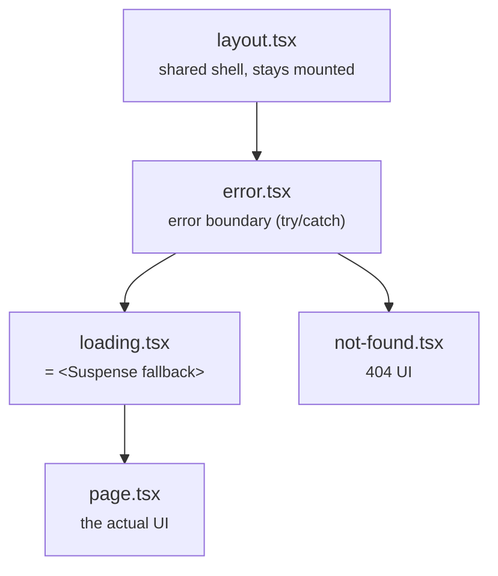
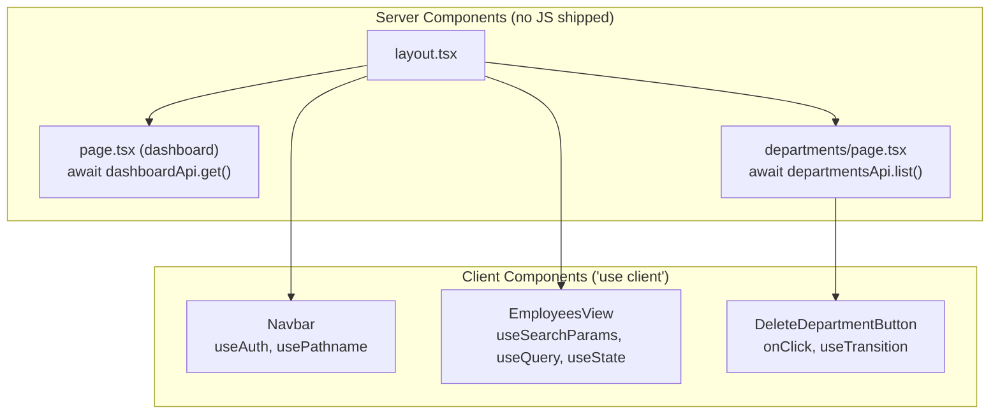

# 7. Routing & rendering

<div class="learn">

**What you'll learn**
- How folders become URLs (App Router), including layouts and dynamic `[id]` segments
- The special files: `page`, `layout`, `loading`, `error`, `not-found`
- **Server Components vs Client Components**: the most important Next.js concept
- Streaming with `<Suspense>`, Cache Components, and **Server Actions**

<p class="meta">⏱ 60 minutes · Files: <code>frontend/src/app/**</code></p>
</div>

## Folders are routes

| File | URL | MVC equivalent |
| --- | --- | --- |
| `app/page.tsx` | `/` | `HomeController.Index` |
| `app/employees/page.tsx` | `/employees` | `EmployeesController.Index` |
| `app/employees/new/page.tsx` | `/employees/new` | `EmployeesController.Create` (GET) |
| `app/employees/[id]/page.tsx` | `/employees/42` | `EmployeesController.Details(int id)` |
| `app/employees/[id]/edit/page.tsx` | `/employees/42/edit` | `EmployeesController.Edit(int id)` |
| `app/login/page.tsx` | `/login` | `AccountController.Login` |

A folder without `page.tsx` is not a route by itself (it can still contain a `layout.tsx` or other files).

::: info 🟣 Coming from .NET
There's no route table and no `MapControllerRoute`. **The folder structure is the routing.** `[id]` is the `{id}` route parameter.
:::

## Special files



| File | Role | In this demo |
| --- | --- | --- |
| `layout.tsx` | UI shared by a segment and its children; **does not re-render on navigation** | root layout with Navbar |
| `page.tsx` | the route's UI | every screen |
| `loading.tsx` | shown instantly while the page renders (wraps the page in `<Suspense>`) | `employees/[id]/loading.tsx` |
| `error.tsx` | catches errors thrown while rendering (must be a Client Component) | `app/error.tsx` with a **Try again** button |
| `not-found.tsx` | shown for unknown URLs or when code calls `notFound()` | `app/not-found.tsx` |
| `route.ts` | an HTTP endpoint (GET/POST handler) instead of a page | not needed, our API is .NET |
| `proxy.ts` (in `src/`) | runs before every matched request (formerly `middleware.ts`) | auth redirect (ch. 13) |

### Dynamic segments: `[id]`

```tsx
// src/app/employees/[id]/page.tsx
import { notFound } from "next/navigation";
import { EmployeeDetails } from "@/components/employees/EmployeeDetails";

// PageProps<"/employees/[id]"> is generated by Next.js → params: Promise<{ id: string }>
export default async function EmployeeDetailsPage({ params }: PageProps<"/employees/[id]">) {
  const { id } = await params;            // params is a Promise in Next.js 15+
  const employeeId = Number(id);
  if (!Number.isInteger(employeeId) || employeeId <= 0) notFound(); // /employees/abc → 404

  return <EmployeeDetails id={employeeId} />;
}
```

::: warning Route params are always strings
`/employees/42` gives `id: "42"`. Convert with `Number(id)` and validate, just like you'd never trust `RouteData.Values["id"]` without parsing.
:::

### Navigation

```tsx
import Link from "next/link";
<Link href={`/employees/${e.id}`}>{e.fullName}</Link>     // client-side navigation, prefetched

import { useRouter } from "next/navigation";
const router = useRouter();
router.push("/employees");       // navigate from code (after saving)
router.replace("/employees?page=2"); // without adding a history entry
router.refresh();                // re-render Server Components with fresh data
```

Use `<Link>`, not `<a href>`, for internal links: it avoids a full page reload and prefetches the target.

## Server Components vs Client Components {#server-components}

This is the concept that differs most from both MVC and "classic" React.

| | **Server Component** (default) | **Client Component** (`"use client"`) |
| --- | --- | --- |
| Runs | on the Next.js server only (at build or request time) | on the server for the first HTML **and** in the browser |
| Can be `async` and `await` data | ✅ | ❌ (use hooks like `useQuery`) |
| `useState`, `useEffect`, event handlers (`onClick`) | ❌ | ✅ |
| Browser APIs (`window`, `document`, `localStorage`) | ❌ | ✅ (inside effects/handlers) |
| Read cookies/headers, secrets, server-only env vars | ✅ | ❌ |
| Ships JavaScript to the browser | **no** | yes |
| Like… | a Razor view rendered on the server | a JavaScript widget on the page |

```tsx
"use client";   // ← first line of the file: this file and everything it imports run in the browser
```

### How the demo uses both



The rule of thumb: **start as a Server Component; add `"use client"` only to the smallest piece that needs interactivity.** In `departments/page.tsx` the table is rendered on the server, and only the Delete button (which needs `onClick` and a dialog) is a Client Component.

::: tip Passing data across the boundary
A Server Component can render a Client Component and pass it **serializable** props (strings, numbers, plain objects, arrays, Dates, and even Server Actions). It cannot pass functions like `onClick={() => …}` defined on the server.
:::

<details>
<summary><b>▶ Deep dive: "Client" components also render on the server</b></summary>

`"use client"` does not mean "only in the browser". For the first request, Next.js renders Client Components to HTML on the server too (so the page isn't blank), then **hydrates** them in the browser (attaches event handlers and state). That's why code like `document.cookie` must run in effects or event handlers, not during render, and why the demo's `AuthContext` uses `useSyncExternalStore` with a server snapshot of `null`.

</details>

## Streaming with `<Suspense>`

A Server Component can `await` slow data. Wrap it in `<Suspense>` and the rest of the page is sent immediately; the slow part streams in when ready.

```tsx
// src/app/page.tsx (dashboard)
export default function DashboardPage() {
  return (
    <>
      <PageHeader title="Dashboard" description="Live numbers from the .NET API" />
      {/* the header is sent immediately; stats stream in when the API answers */}
      <Suspense fallback={<DashboardSkeleton />}>
        <DashboardStats />
      </Suspense>
    </>
  );
}

async function DashboardStats() {
  const stats = await dashboardApi.get();   // runs on the server, errors go to error.tsx
  return <div>…{stats.totalEmployees}…</div>;
}
```

`loading.tsx` is the same thing for a whole route segment: Next.js wraps `page.tsx` in `<Suspense fallback={<Loading />}>` automatically.

## Cache Components: why `<Suspense>` is required {#cache-components}

New Next.js 16 projects enable **Cache Components** (`cacheComponents: true`):

- At build time Next.js **prerenders a static shell** of every route (layout, headers, fallbacks).
- Anything **request-specific** must be inside a `<Suspense>` boundary so it can stream in at request time: uncached `fetch`, `cookies()`, `headers()`, `params`, `searchParams`, and client hooks like `usePathname()` and `useSearchParams()`.
- Data is **fresh by default**. To cache, add the `"use cache"` directive (+ `cacheLife("hours")`) to a function or component.

If you forget the boundary, `next build` stops with a clear message. The demo hit exactly this:

```txt
Error: Route "/employees/[id]": Next.js encountered URL data `usePathname()`
in a Client Component outside of `<Suspense>`.
Ways to fix this:
  - [stream] Wrap the component in `<Suspense fallback={...}>` …
```

The fix in `Navbar.tsx`: render the links without highlight as the fallback, and the highlighted version inside `<Suspense>`:

```tsx
<Suspense fallback={<NavLinkList pathname={null} />}>
  <ActiveNavLinks />   {/* calls usePathname() */}
</Suspense>
```

| Need | Do |
| --- | --- |
| fresh data on each request | `await fetch(...)` inside `<Suspense>` (or a route with `loading.tsx`) |
| `params` / `searchParams` | add `loading.tsx` to that route segment, or wrap the reading component in `<Suspense>` |
| data that rarely changes | a function with `"use cache"` + `cacheLife(...)` |
| a client component using `useSearchParams` | wrap it in `<Suspense>` (see `app/employees/page.tsx`) |

<details>
<summary><b>▶ Deep dive: Next.js keeps pages mounted (React <code>&lt;Activity&gt;</code>)</b></summary>

With Cache Components, when you navigate away, Next.js keeps the previous page **mounted but hidden** for a while, so going Back restores scroll position and form state. Two consequences the demo handles:

1. **Hard-coded element ids clash.** `/employees/new` (hidden) and `/employees/5/edit` (visible) both had `<input id="salary">`. `<label for="salary">` then pointed at the hidden input. Fix: `useId()` to generate unique ids per form instance (`EmployeeForm.tsx`).
2. **Effects re-run when a hidden page becomes visible.** A `useEffect` that navigates when `state.success` is true would fire again when you come back. Fix: react to results inside the event/action itself (`DepartmentForm.tsx`).

</details>

## Server Actions {#server-actions}

A **Server Action** is an `async` function marked `"use server"`. It runs on the Next.js server, but you can call it from a form or a button in the browser; Next.js turns the call into a POST request for you.

```ts
// src/app/departments/actions.ts
"use server";

export async function deleteDepartment(id: number) {
  const token = await getServerToken();            // read the JWT cookie
  if (!token) return { ok: false, message: "Please log in first." };
  try {
    await departmentsApi.remove(id, token);        // call the .NET API (server → server)
    revalidatePath("/departments");                // re-render pages showing departments
    return { ok: true, message: "Department deleted." };
  } catch (err) {
    if (err instanceof ApiError) return { ok: false, message: err.message }; // e.g. 409
    throw err;
  }
}
```

Called from a Client Component:

```tsx
// src/components/departments/DeleteDepartmentButton.tsx
const [isPending, startTransition] = useTransition();

function handleConfirm() {
  startTransition(async () => {
    const result = await deleteDepartment(id);   // looks like a local call, is a POST
    if (result.ok) toast.success(`"${name}" deleted.`);
    else toast.error(result.message);
  });
}
```

Forms can post straight to an action with `<form action={formAction}>`; see `DepartmentForm.tsx` and [chapter 10](./10-forms-and-validation#style-3-server-action-useactionstate).

::: info 🟣 Coming from .NET
A Server Action is very close to an MVC `[HttpPost]` action: form fields arrive as `FormData`, you validate, call your service, and return a result. Instead of `RedirectToAction` you call `revalidatePath()` / `redirect()`.
:::

::: danger Server Actions are public endpoints
Anyone can POST to them, not just your UI. **Always check authentication/authorization inside the action** (the demo checks the token, and the .NET API checks it again).
:::

## Two data-fetching styles, side by side

The demo deliberately uses both, so you can compare:

| | `/departments` (server-first) | `/employees` (client-first) |
| --- | --- | --- |
| Read | `async` Server Component `await departmentsApi.list()` | `useQuery` in a Client Component |
| Write | Server Actions + `revalidatePath` | `useMutation` + `invalidateQueries` |
| Who calls the .NET API | the Next.js server | the browser (needs **CORS**) |
| Base URL | `API_BASE_URL` (runtime, server-only) | `NEXT_PUBLIC_API_BASE_URL` (build time) |
| Best for | mostly-read pages, SEO, simplest code | highly interactive screens: filters, optimistic UI, caching across pages |

## Recap

- Folders = URLs; `[id]` = route parameter; special files give layouts, loading and error UI.
- Components are **Server Components by default**; add `"use client"` for state, effects and events.
- With Cache Components, request-time data needs a `<Suspense>` boundary (or `loading.tsx`).
- Server Actions are typed POST endpoints you call like functions, so always authorize inside them.

## Try it yourself

Add a `loading.tsx` to `app/departments/` showing "Loading departments…". When is it visible?

::: details Answer
```tsx
// src/app/departments/loading.tsx
export default function Loading() {
  return <p className="p-8 text-slate-500">Loading departments…</p>;
}
```
It shows while the departments route renders after you navigate. Because the page already has its own `<Suspense>` around the table, you'll mostly notice it on slow connections. Open DevTools → Network → *Slow 4G* to see it.
:::

[Next: The .NET API walkthrough →](./08-backend-api-walkthrough)
