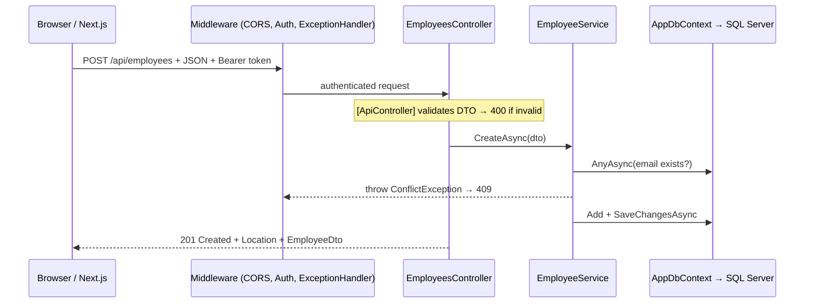
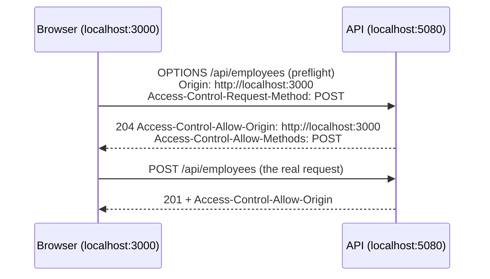

# 8. The .NET API walkthrough

<div class="learn">

**What you'll learn**
- The exact commands used to create the backend
- How the API is designed for a React client: DTOs, status codes, ProblemDetails, CORS
- EF Core code-first with migrations, seeding and optimistic concurrency
- OpenAPI + Scalar, JWT, and integration tests

<p class="meta">⏱ 45 minutes · You know most of this already. Focus on the "for a SPA" parts.</p>
</div>

<FileTree name="backend" title="backend/" />

## Create it from scratch

```powershell
mkdir backend; cd backend
dotnet new sln -n EmployeeDemo                                   # creates EmployeeDemo.slnx (.NET 10)
dotnet new webapi -n EmployeeDemo.Api -o src/EmployeeDemo.Api --use-controllers
dotnet new xunit  -n EmployeeDemo.Api.Tests -o tests/EmployeeDemo.Api.Tests
dotnet sln add src/EmployeeDemo.Api tests/EmployeeDemo.Api.Tests
dotnet add tests/EmployeeDemo.Api.Tests reference src/EmployeeDemo.Api

cd src/EmployeeDemo.Api
dotnet add package Microsoft.EntityFrameworkCore.SqlServer
dotnet add package Microsoft.EntityFrameworkCore.Design
dotnet add package Microsoft.AspNetCore.Authentication.JwtBearer
dotnet add package Scalar.AspNetCore
cd ../../tests/EmployeeDemo.Api.Tests
dotnet add package Microsoft.AspNetCore.Mvc.Testing

cd ../..
dotnet new tool-manifest                       # dotnet-tools.json
dotnet tool install dotnet-ef --version 10.0.14
```

::: tip Controllers vs Minimal APIs
`--use-controllers` keeps the familiar MVC style. The only minimal-API endpoint in the demo is `/api/health` in `Program.cs`, so you can compare the two styles.
:::

## The request flow



## `Program.cs` {#program-cs}

```csharp
// Controllers + enums as strings ("FullTime" instead of 0)
builder.Services.AddControllers()
    .AddJsonOptions(o => o.JsonSerializerOptions.Converters.Add(new JsonStringEnumConverter()));

builder.Services.AddDbContext<AppDbContext>(options =>
    options.UseSqlServer(builder.Configuration.GetConnectionString("DefaultConnection")));

builder.Services.AddScoped<IEmployeeService, EmployeeService>();
builder.Services.AddScoped<IDepartmentService, DepartmentService>();
builder.Services.AddScoped<IAuthService, AuthService>();

builder.Services.AddProblemDetails();                          // RFC 7807 error bodies
builder.Services.AddExceptionHandler<GlobalExceptionHandler>(); // exceptions → ProblemDetails

// CORS: allow the Next.js origin to call this API from the browser
var allowedOrigins = builder.Configuration.GetSection("Cors:AllowedOrigins").Get<string[]>() ?? [];
builder.Services.AddCors(o => o.AddPolicy("frontend", p => p
    .WithOrigins(allowedOrigins).AllowAnyHeader().AllowAnyMethod()));

builder.Services.AddAuthentication(JwtBearerDefaults.AuthenticationScheme).AddJwtBearer(/* … */);
builder.Services.AddOpenApi();

var app = builder.Build();

app.UseExceptionHandler();
app.UseStatusCodePages();          // empty 401/404 → ProblemDetails body too
if (app.Environment.IsDevelopment()) { app.MapOpenApi(); app.MapScalarApiReference(); }
else { app.UseHttpsRedirection(); }
app.UseCors("frontend");           // ⚠ before auth
app.UseAuthentication();
app.UseAuthorization();
app.MapControllers();
```

## Entities, DbContext and migrations

The `Employee` entity was designed so that the form needs **every common input type**: text, email, phone, date (`DateOnly`), number (`decimal`), checkbox (`bool`), enum dropdown, and a foreign-key dropdown.

```csharp
// Data/AppDbContext.cs (excerpt)
modelBuilder.Entity<Employee>(e =>
{
    e.Property(x => x.Email).HasMaxLength(150).IsRequired();
    e.Property(x => x.Salary).HasPrecision(18, 2);
    e.Property(x => x.EmploymentType).HasConversion<string>().HasMaxLength(20); // stored as text
    e.Property(x => x.RowVersion).IsRowVersion();                                // SQL rowversion
    e.HasIndex(x => x.Email).IsUnique();
    e.HasOne(x => x.Department).WithMany(d => d.Employees)
     .HasForeignKey(x => x.DepartmentId)
     .OnDelete(DeleteBehavior.Restrict);   // can't delete a department that has employees
});
```

```powershell
dotnet ef migrations add InitialCreate --project src/EmployeeDemo.Api --output-dir Data/Migrations
dotnet ef database update --project src/EmployeeDemo.Api
```

In **Development**, `appsettings.Development.json` sets `Database:MigrateOnStartup` and `Database:SeedDemoData` to `true`, so `dotnet run` creates the database and inserts 5 departments + 42 employees (`Data/DbSeeder.cs`). In production we use SQL scripts instead ([chapter 16](./16-build-and-package#database-changes)).

## DTOs designed for the front end

- **Never return entities**: separate `EmployeeDto` (read), `EmployeeCreateDto` (POST), `EmployeeUpdateDto` (PUT, adds `RowVersion`).
- **camelCase JSON** (System.Text.Json default) → `firstName` in TypeScript.
- **Enums as strings** → `"FullTime"` maps to a TypeScript union type.
- **`DateOnly`** → `"2025-01-15"`, exactly what `<input type="date">` uses.
- **Convenience fields** for the UI: `fullName`, `departmentName`, `employeeCount`.
- **Paging envelope** `PagedResult<T>`: `items, page, pageSize, totalCount, totalPages`.

```json
GET /api/employees?pageSize=1
{
  "items": [{
    "id": 1, "firstName": "Aarav", "lastName": "Sharma", "fullName": "Aarav Sharma",
    "email": "aarav.sharma0@demo.local", "phone": "+1-555-700-2268",
    "hireDate": "2025-10-02", "salary": 110000.00, "isActive": false,
    "employmentType": "FullTime", "departmentId": 1, "departmentName": "Engineering",
    "rowVersion": "AAAAAAAAB9E=", "createdAt": "2026-11-08T14:03:24.9788456", "updatedAt": null
  }],
  "page": 1, "pageSize": 1, "totalCount": 43, "totalPages": 43
}
```

## Endpoints and status codes

| Method & route | Success | Errors | Auth |
| --- | --- | --- | --- |
| `GET /api/employees?search=&departmentId=&isActive=&sortBy=&sortDir=&page=&pageSize=` | 200 `PagedResult` | 400 bad query | – |
| `GET /api/employees/{id}` | 200 | 404 | – |
| `POST /api/employees` | **201** + `Location` | 400 validation, 409 duplicate email | 🔒 |
| `PUT /api/employees/{id}` | 200 (new `rowVersion`) | 400, 404, **409 concurrency** | 🔒 |
| `DELETE /api/employees/{id}` | **204** | 404 | 🔒 |
| `GET /api/departments` | 200 (with `employeeCount`) | | – |
| `POST/PUT/DELETE /api/departments…` | 201 / 200 / 204 | 400, 404, **409 has employees / duplicate code** | 🔒 |
| `POST /api/auth/login` | 200 `{ token, username, role, expiresAt }` | 401 | – |
| `GET /api/dashboard` | 200 stats | | – |
| `GET /api/health` | 200 `{ status, version, environment }` | | – |

## Errors as ProblemDetails

The React client only has to understand **one error format**. Three sources produce it:

1. `[ApiController]` model validation → **400** `ValidationProblemDetails`
2. `GlobalExceptionHandler` (an `IExceptionHandler`) → **404 / 409 / 500**
3. `UseStatusCodePages()` → bodies for empty **401 / 403**

::: code-group

```json [400 validation]
{
  "type": "https://tools.ietf.org/html/rfc9110#section-15.5.1",
  "title": "One or more validation errors occurred.",
  "status": 400,
  "errors": {
    "Email": ["The Email field is not a valid e-mail address."],
    "FirstName": ["The FirstName field is required."],
    "DepartmentId": ["Please select a department."]
  },
  "traceId": "00-d81a1cd5…-00"
}
```

```json [409 duplicate email]
{
  "type": "https://tools.ietf.org/html/rfc9110#section-15.5.10",
  "title": "Conflict",
  "status": 409,
  "detail": "The email 'aarav.sharma0@demo.local' is already used by another employee.",
  "errors": { "email": ["The email 'aarav.sharma0@demo.local' is already used by another employee."] },
  "traceId": "00-c44103c2…-00"
}
```

```json [409 business rule]
{
  "type": "https://tools.ietf.org/html/rfc9110#section-15.5.10",
  "title": "Conflict",
  "status": 409,
  "detail": "'Engineering' still has 10 employee(s). Move or delete them first.",
  "traceId": "00-c3e76b4c…-00"
}
```

```json [404]
{
  "type": "https://tools.ietf.org/html/rfc9110#section-15.5.5",
  "title": "Not found",
  "status": 404,
  "detail": "Employee 999 was not found."
}
```

```json [401]
{
  "type": "https://tools.ietf.org/html/rfc9110#section-15.5.2",
  "title": "Unauthorized",
  "status": 401
}
```

:::

The `errors` dictionary on a **409** is a deliberate design choice: `ConflictException(message, field: "email")` lets the React form show the message **under the Email input**, exactly like a validation error.

```csharp
// Infrastructure/GlobalExceptionHandler.cs (excerpt)
var (status, title, detail) = exception switch
{
    NotFoundException e => (404, "Not found", e.Message),
    ConflictException e => (409, "Conflict", e.Message),
    DbUpdateConcurrencyException => (409, "Concurrency conflict",
        "This record was changed by someone else. Reload it and try again."),
    _ => (500, "Server error", "An unexpected error occurred. Please try again later.")
};
```

::: danger Never leak exception details
The 500 branch returns a generic message and logs the real exception. Stack traces in API responses are an information-disclosure risk.
:::

## Optimistic concurrency with `rowversion`

1. `GET` returns `rowVersion: "AAAAAAAAB9E="` (base64 of SQL's `rowversion`).
2. The edit form sends it back in the `PUT` body.
3. The service tells EF which version the client saw:

```csharp
db.Entry(employee).Property(e => e.RowVersion).OriginalValue = Convert.FromBase64String(dto.RowVersion);
employee.Apply(dto);
await db.SaveChangesAsync(ct);   // UPDATE … WHERE Id = @id AND RowVersion = @original
```

If someone else saved in between, zero rows match → `DbUpdateConcurrencyException` → **409**, and the UI offers **Reload latest version**.


<p class="caption">Two tabs edited the same employee; the second save gets a 409.</p>

## CORS: why the browser needs it {#cors}

The web app runs on `http://localhost:3000`, the API on `http://localhost:5080`. Different port = **different origin**. Browsers block JavaScript from reading responses from another origin **unless the server allows it** with `Access-Control-Allow-*` headers.



What the demo API actually answers (captured with PowerShell):

```txt
OPTIONS /api/employees  Origin: http://localhost:3000
→ Access-Control-Allow-Origin  : http://localhost:3000
→ Access-Control-Allow-Methods : POST
→ Access-Control-Allow-Headers : authorization,content-type

GET /api/departments  Origin: http://evil.example
→ (no Access-Control-Allow-Origin header → the browser refuses to give the response to JS)
```

::: warning CORS facts that save hours
- CORS is enforced by **browsers only**. Postman, curl, and server-to-server calls (Server Components, Server Actions) are not affected.
- `UseCors()` must come **before** `UseAuthentication()`/`UseAuthorization()`, or preflights fail with 401.
- An unhandled 500 can *look* like a CORS error in the browser console. Check the API log first.
- In production, list your real web origin (`Cors__AllowedOrigins__0=https://employees.mycompany.com`). Never use `AllowAnyOrigin()` together with credentials.
:::

## OpenAPI + Scalar

`AddOpenApi()` generates `/openapi/v1.json`; `MapScalarApiReference()` serves an interactive UI at **http://localhost:5080/scalar** (Development only). It's the modern replacement for Swagger UI in .NET 9+.

You can also use `EmployeeDemo.Api.http` in VS Code (REST Client) or Visual Studio.

## JWT authentication (overview)

`POST /api/auth/login` checks the demo users in `appsettings.json` and returns a signed JWT. `[Authorize]` on the controllers protects every write; reads are `[AllowAnonymous]`. The full flow, including the React side, is in [chapter 13](./13-authentication).

## Integration tests

`ApiFactory` starts the **real API in memory** (`WebApplicationFactory<Program>`) against a throw-away database `EmployeeDemoDb_Tests`:

```csharp
[Fact]
public async Task Duplicate_email_returns_409_with_email_error()
{
    var client = await factory.CreateAuthenticatedClientAsync();
    await client.PostAsJsonAsync("/api/employees", NewEmployee("dupe@demo.local"), Json);

    var response = await client.PostAsJsonAsync("/api/employees", NewEmployee("dupe@demo.local"), Json);

    Assert.Equal(HttpStatusCode.Conflict, response.StatusCode);
    var problem = await response.Content.ReadFromJsonAsync<JsonElement>();
    Assert.True(problem.GetProperty("errors").TryGetProperty("email", out _));
}
```

```powershell
cd backend
dotnet test     # 10 tests: paging, 401, 400, 201 round-trip, 409 email, 409 concurrency, 404, departments
```

The tests pin down the **contract the React app depends on** (status codes and error shapes), so a backend refactor can't silently break the UI.

## Recap

- Design the API for the client: DTOs, camelCase, string enums, `DateOnly`, paging envelopes.
- One error format everywhere: **ProblemDetails**, with `errors` for field-level messages.
- CORS is a browser rule; configure it explicitly per environment.
- `rowversion` + 409 gives you safe concurrent edits.

## Try it yourself

Add a `GET /api/departments/{id}/employees` endpoint that returns the employees of one department.

::: details Hint
You don't need a new endpoint! `GET /api/employees?departmentId=3` already does this. Look at how the department table links its employee count to `/employees?departmentId=…`. Reusing query parameters keeps the API small.
:::

[Next: Calling the backend API →](./09-integrating-backend-apis)
