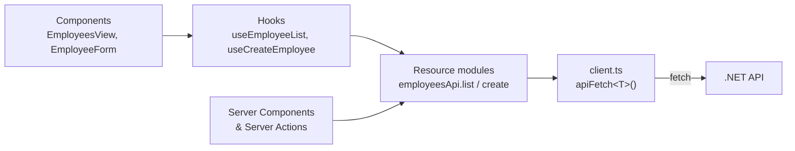
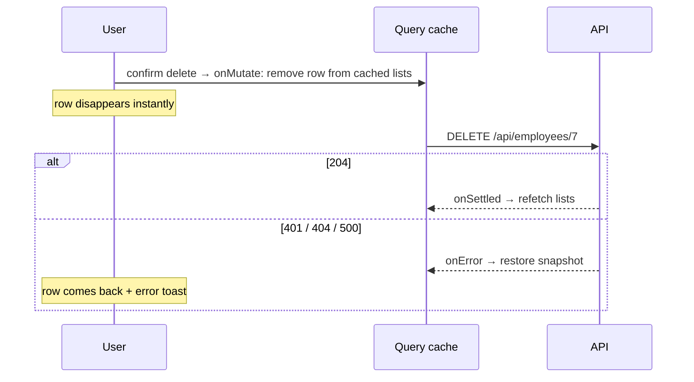

# 9. Calling the backend API

<div class="learn">

**What you'll learn**
- Configure API URLs with environment variables (and the `NEXT_PUBLIC_` trap)
- Build one typed API client that handles JSON, JWT, 204 and ProblemDetails errors
- Fetch on the server (Server Components) vs in the browser (TanStack Query)
- Caching, invalidation, optimistic updates, cancellation, and fixing CORS errors

<p class="meta">⏱ 60 minutes · Files: <code>src/lib/api/*</code>, <code>src/hooks/*</code>, <code>.env.*</code></p>
</div>

## The layers



::: info 🟣 Coming from .NET
`client.ts` ≈ a typed `HttpClient` wrapper, `employeesApi` ≈ a typed client class (`IEmployeesClient`), hooks ≈ the service layer that adds caching and state for the UI.
:::

## Environment variables {#environment-variables}

```ini
# frontend/.env.development  (loaded by `npm run dev`)
NEXT_PUBLIC_API_BASE_URL=http://localhost:5080   # used in the BROWSER
API_BASE_URL=http://localhost:5080               # used on the NEXT.JS SERVER
```

| | `NEXT_PUBLIC_API_BASE_URL` | `API_BASE_URL` |
| --- | --- | --- |
| Available in | browser **and** server | **server only** (Server Components, Server Actions, `proxy.ts`) |
| Value fixed | at **build time** (copied into the JS bundle) | at **runtime** (read from the process environment) |
| Change it in production | **rebuild** | restart with a different env var |
| Can hold secrets | ❌ never, anyone can read the bundle | ✅ |

**Load order** (first match wins): real environment variables → `.env.$(NODE_ENV).local` → `.env.local` → `.env.$(NODE_ENV)` → `.env`. `NODE_ENV` is `development` for `next dev` and `production` for `next build`/`next start`.

| Next.js file | ASP.NET Core equivalent |
| --- | --- |
| `.env` | `appsettings.json` |
| `.env.development` / `.env.production` | `appsettings.Development.json` / `appsettings.Production.json` |
| `.env.local` (git-ignored) | user secrets |
| real env vars | real env vars (same idea: they override files) |

::: warning The `NEXT_PUBLIC_` trap
`process.env.NEXT_PUBLIC_API_BASE_URL` is **replaced by its value during `next build`**. If you build once and deploy the same files to test and prod, both will call the URL you built with. That's why `scripts/build-frontend.ps1` takes `-ApiBaseUrl`. Details in [chapter 16](./16-build-and-package#environment-variables-per-environment).
:::

::: tip Restart after changing `.env` files
The dev server reads env files at start-up.
:::

## The API client {#the-api-client}

One function does all HTTP work. Every other file uses it.

```ts
// src/lib/api/client.ts (abridged)
export function getApiBaseUrl(): string {
  const isServer = typeof window === "undefined";
  const url = isServer
    ? (process.env.API_BASE_URL ?? process.env.NEXT_PUBLIC_API_BASE_URL)
    : process.env.NEXT_PUBLIC_API_BASE_URL;
  if (!url) throw new Error("API base URL is not configured. See frontend/.env.example");
  return url.replace(/\/+$/, "");
}

export class ApiError extends Error {
  readonly status: number;
  readonly fieldErrors: Record<string, string>;   // { email: "Already used" }
  constructor(status: number, problem: ProblemDetails | null, fallback: string) {
    super(problem?.detail ?? problem?.title ?? fallback);
    this.status = status;
    this.fieldErrors = normalizeFieldErrors(problem?.errors); // "FirstName" → "firstName"
  }
}

export async function apiFetch<T>(path: string, options: RequestOptions = {}): Promise<T> {
  const { method = "GET", body, token, query, signal } = options;

  const headers: Record<string, string> = { Accept: "application/json" };
  if (body !== undefined) headers["Content-Type"] = "application/json";
  if (token) headers["Authorization"] = `Bearer ${token}`;

  let response: Response;
  try {
    response = await fetch(buildUrl(path, query), {
      method, headers, signal,
      body: body !== undefined ? JSON.stringify(body) : undefined,
    });
  } catch (err) {
    if (err instanceof DOMException && err.name === "AbortError") throw err;
    throw new ApiError(0, null, "Cannot reach the API. Is the .NET backend running?");
  }

  if (!response.ok) {
    let problem: ProblemDetails | null = null;
    try { problem = await response.json(); } catch { /* empty body */ }
    throw new ApiError(response.status, problem, `Request failed with status ${response.status}`);
  }

  if (response.status === 204) return undefined as T;   // DELETE → No Content
  return (await response.json()) as T;
}
```

What it gives every caller for free:

| Concern | Handled by |
| --- | --- |
| base URL per environment | `getApiBaseUrl()` |
| query strings, skipping empty values | `buildUrl(path, { search, page })` |
| JSON body + headers | `body` option |
| JWT | `token` option → `Authorization: Bearer …` |
| 204 No Content | returns `undefined` |
| API down / CORS blocked | `ApiError(0, …)` with a helpful message |
| 4xx/5xx | `ApiError` with `status`, `message` (ProblemDetails `detail`), `fieldErrors` |
| cancellation | `signal` (`AbortSignal` ≈ `CancellationToken`) |

### Resource modules: one function per endpoint

```ts
// src/lib/api/employees.ts
export const employeesApi = {
  list:   (query: EmployeeQuery, signal?: AbortSignal) =>
            apiFetch<PagedResult<Employee>>("/api/employees", { query: { ...query }, signal }),
  get:    (id: number, signal?: AbortSignal) => apiFetch<Employee>(`/api/employees/${id}`, { signal }),
  create: (data: EmployeeCreateRequest, token: string | null) =>
            apiFetch<Employee>("/api/employees", { method: "POST", body: data, token }),
  update: (id: number, data: EmployeeUpdateRequest, token: string | null) =>
            apiFetch<Employee>(`/api/employees/${id}`, { method: "PUT", body: data, token }),
  remove: (id: number, token: string | null) =>
            apiFetch<void>(`/api/employees/${id}`, { method: "DELETE", token }),
};
```

The types (`Employee`, `EmployeeCreateRequest`, `PagedResult<T>`) live in `src/types/` and mirror the C# DTOs one-to-one.

::: tip Generating types instead of writing them
For big APIs you can generate TypeScript types from `/openapi/v1.json` with tools like `openapi-typescript` or Kiota. The demo writes them by hand so you can see what's going on.
:::

## Style A: fetch on the server (Server Components)

```tsx
// src/app/departments/page.tsx
async function DepartmentTable() {
  const [departments, user] = await Promise.all([departmentsApi.list(), getServerUser()]);
  return <table>…{departments.map((d) => <tr key={d.id}>…</tr>)}…</table>;
}
```

- Runs on the Next.js server → uses `API_BASE_URL`, **no CORS**, can read cookies.
- Wrapped in `<Suspense>` so it streams (chapter 7).
- With Cache Components, `fetch` is **not cached**: always fresh data.
- After a mutation, a Server Action calls `revalidatePath("/departments")` to re-render.

## Style B: fetch in the browser with TanStack Query {#tanstack-query}

For interactive screens, **TanStack Query** (a.k.a. React Query) manages server data in the browser: loading/error state, caching, de-duplication, background refetching, retries and cancellation.

::: info 🟣 Coming from .NET
Think `IMemoryCache` + `HttpClient` + Polly, keyed by a **query key**, and bound to your UI so components re-render when data arrives.
:::

### Setup (once)

```tsx
// src/app/providers.tsx (excerpt)
function createQueryClient() {
  return new QueryClient({
    defaultOptions: {
      queries: {
        staleTime: 30_000,              // cached data counts as fresh for 30 s
        retry: (count, error) =>        // don't retry 4xx, retry network/5xx once
          !(error instanceof ApiError && error.status >= 400 && error.status < 500) && count < 1,
        refetchOnWindowFocus: false,
      },
    },
    mutationCache: new MutationCache({
      onError: (error) => {             // one place for "session expired"
        if (error instanceof ApiError && error.status === 401) signalUnauthorized();
      },
    }),
  });
}

export function Providers({ children }: { children: React.ReactNode }) {
  const [queryClient] = useState(createQueryClient);   // one per browser tab
  return <QueryClientProvider client={queryClient}>…{children}…</QueryClientProvider>;
}
```

### Reading: `useQuery`

```ts
// src/hooks/useEmployees.ts
export const employeeKeys = {
  all: ["employees"] as const,
  lists: () => [...employeeKeys.all, "list"] as const,
  list: (query: EmployeeQuery) => [...employeeKeys.lists(), query] as const,
  detail: (id: number) => [...employeeKeys.all, "detail", id] as const,
};

export function useEmployeeList(query: EmployeeQuery) {
  return useQuery({
    queryKey: employeeKeys.list(query),                         // cache key includes the filters
    queryFn: ({ signal }) => employeesApi.list(query, signal),  // signal cancels stale requests
    placeholderData: keepPreviousData,                          // keep old page visible while loading next
  });
}
```

```tsx
// src/components/employees/EmployeesView.tsx
const { data, isPending, isError, error, isFetching, refetch } = useEmployeeList(query);
```

| Field | Meaning |
| --- | --- |
| `isPending` | no data yet (first load) → show spinner |
| `isFetching` | any request in flight (also background refresh) → small spinner in the search box |
| `isError` / `error` | the `ApiError` thrown by `apiFetch` |
| `data` | the typed `PagedResult<Employee>` |
| `refetch()` | "Retry" button |

Because the **query key contains the filters**, changing page or search automatically fetches, and going back to a previous page is instant (cached).

### Writing: `useMutation` + invalidation

```ts
export function useCreateEmployee() {
  const queryClient = useQueryClient();
  const { token } = useAuth();
  return useMutation({
    mutationFn: (data: EmployeeCreateRequest) => employeesApi.create(data, token),
    onSuccess: () => queryClient.invalidateQueries({ queryKey: employeeKeys.lists() }), // lists are stale now
  });
}
```

### Optimistic delete with rollback

The row disappears **immediately**; if the API fails, it comes back.

```ts
export function useDeleteEmployee() {
  // …
  return useMutation({
    mutationFn: (id: number) => employeesApi.remove(id, token),
    onMutate: async (id) => {
      await queryClient.cancelQueries({ queryKey: employeeKeys.lists() });
      const previous = queryClient.getQueriesData<PagedResult<Employee>>({ queryKey: employeeKeys.lists() });
      queryClient.setQueriesData<PagedResult<Employee>>({ queryKey: employeeKeys.lists() }, (old) =>
        old ? { ...old, items: old.items.filter((e) => e.id !== id), totalCount: old.totalCount - 1 } : old);
      return { previous };                          // → context
    },
    onError: (_err, _id, context) =>
      context?.previous.forEach(([key, data]) => queryClient.setQueryData(key, data)),   // roll back
    onSettled: () => queryClient.invalidateQueries({ queryKey: employeeKeys.all }),     // re-sync
  });
}
```



::: tip Open the TanStack devtools
In dev mode, click the TanStack logo (bottom-right) to see every cached query, its key, state and data. Great for understanding when refetches happen.
:::

## State in the URL: search, filters, sorting, paging

The list's filters live in the **query string** (`/employees?search=ali&sortBy=salary&page=2`), not in `useState`:

```tsx
const searchParams = useSearchParams();
const query = readQuery(searchParams);          // → typed EmployeeQuery

function updateQuery(changes) {
  const next = new URLSearchParams(searchParams.toString());
  for (const [key, value] of Object.entries(changes)) {
    if (value === undefined || value === "") next.delete(key);
    else next.set(key, String(value));
  }
  if (!("page" in changes)) next.delete("page");  // new filter → back to page 1
  router.replace(`${pathname}?${next.toString()}`, { scroll: false });
}
```

Benefits: refresh keeps filters, links are shareable, the Back button works, and the query key changes automatically.

### Debounced search

```ts
// src/hooks/useDebouncedCallback.ts: call the API once the user pauses typing
const pushSearch = useDebouncedCallback((text: string) => onChange({ search: text.trim() || undefined }), 400);

<Input value={searchText} onChange={(e) => { setSearchText(e.target.value); pushSearch(e.target.value); }} />
```

## Error handling checklist

| Situation | What the user sees | Where |
| --- | --- | --- |
| API not running | "Cannot reach the API…" + Retry | `apiFetch` → `ErrorAlert` |
| 400 validation | messages under each field | `EmployeeForm` → `setError` |
| 401 on a write | toast "session expired" + redirect to `/login` | `MutationCache.onError` → `AuthProvider` |
| 404 | "Employee not found" state | `EmployeeDetails` |
| 409 duplicate | message under the field | `fieldErrors` |
| 409 concurrency | banner + "Reload latest version" | `EmployeeForm` |
| 409 business rule | toast with the API's `detail` | `DeleteDepartmentButton` |
| Server Component throws | `error.tsx` with **Try again** | `app/error.tsx` |

## Fixing CORS errors

The console shows something like:

```txt
Access to fetch at 'http://localhost:5080/api/employees' from origin 'http://localhost:3000'
has been blocked by CORS policy: No 'Access-Control-Allow-Origin' header is present…
```

1. Is the API running and returning 2xx/4xx (not crashing with 500)? Check its console.
2. Is the web origin listed in `Cors:AllowedOrigins` (exact scheme + host + port, no trailing slash)?
3. Is `app.UseCors(...)` before `UseAuthentication()`?
4. Are you calling the right URL (`NEXT_PUBLIC_API_BASE_URL`, rebuilt after changing it)?

::: tip Avoiding CORS entirely
Server Components and Server Actions call the API server-to-server, so CORS never applies. Another option is a Next.js `rewrites` proxy (`/api/:path*` → the .NET API) so the browser only talks to its own origin.
:::

## Recap

- One `apiFetch<T>()` handles base URL, JSON, JWT, 204 and ProblemDetails → `ApiError`.
- `NEXT_PUBLIC_*` = build-time & public; other env vars = server-only & runtime.
- Server Components fetch on the server (no CORS); TanStack Query fetches and caches in the browser.
- Query keys + invalidation keep the UI in sync; optimistic updates make it feel instant.

## Try it yourself

Show the total number of employees next to the page title, reusing the cached list query.

::: details Solution
```tsx
const { data } = useEmployeeList(query);
<span className="text-slate-500">({data?.totalCount ?? "…"})</span>
```
No new request is made: it's the same query key the table already uses.
:::

[Next: Forms & validation →](./10-forms-and-validation)
