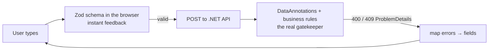

# 10. Forms & validation

<div class="learn">

**What you'll learn**
- Controlled vs uncontrolled inputs
- Three ways to build a form, all used in the demo: plain `useState`, **React Hook Form + Zod**, and **Server Actions + `useActionState`**
- Mapping server validation errors (400/409) back onto form fields
- Create and edit with one shared form

<p class="meta">⏱ 45 minutes · Files: <code>LoginForm.tsx</code>, <code>EmployeeForm.tsx</code>, <code>DepartmentForm.tsx</code>, <code>lib/validation/*</code></p>
</div>

## Validate twice, always



::: danger The server is the source of truth
Client-side validation is a **UX feature**, not security. Anyone can call the API directly. Every rule must also exist in the API. Rules that need the database (unique email) can *only* live there.
:::

## Controlled vs uncontrolled inputs

| | Controlled | Uncontrolled |
| --- | --- | --- |
| Value lives in | React state (`value={x}` + `onChange`) | the DOM (`defaultValue`, read on submit) |
| Re-renders | on every keystroke | none while typing |
| Use for | small forms, inputs that drive other UI (search box) | big forms (React Hook Form), Server Action forms |

## Style 1: `useState` (the login form)

```tsx
// src/components/auth/LoginForm.tsx (abridged)
const [username, setUsername] = useState("admin");
const [password, setPassword] = useState("");
const [error, setError] = useState<string | null>(null);
const [isSubmitting, setIsSubmitting] = useState(false);

async function handleSubmit(e: React.FormEvent<HTMLFormElement>) {
  e.preventDefault();                 // no full-page POST
  setError(null);
  setIsSubmitting(true);
  try {
    await login(username, password);
    router.push(returnUrl);
  } catch (err) {
    setError(err instanceof ApiError ? err.message : "Login failed");
  } finally {
    setIsSubmitting(false);
  }
}

<form onSubmit={handleSubmit}>
  <Input value={username} onChange={(e) => setUsername(e.target.value)} />
  <Input type="password" value={password} onChange={(e) => setPassword(e.target.value)} />
  <Button type="submit" isLoading={isSubmitting} disabled={!username || !password}>Log in</Button>
</form>
```

Fine for 2–3 fields. Beyond that, the boilerplate grows fast.

## Style 2: React Hook Form + Zod (the employee form)

### The schema = your DataAnnotations

<DotnetVsReact dotnetTitle="Dtos/EmployeeDtos.cs" reactTitle="lib/validation/employee.ts">
<template #dotnet>

```csharp
public class EmployeeCreateDto
{
    [Required, StringLength(50)]
    public string FirstName { get; set; } = "";

    [Required, EmailAddress, StringLength(150)]
    public string Email { get; set; } = "";

    [Range(0, 10_000_000)]
    public decimal Salary { get; set; }

    [Range(1, int.MaxValue,
      ErrorMessage = "Please select a department.")]
    public int DepartmentId { get; set; }
}
```

</template>
<template #react>

```ts
export const employeeSchema = z.object({
  firstName: z.string().trim()
    .min(1, "First name is required").max(50),

  email: z.email("Enter a valid email address")
    .max(150),

  salary: z.number("Salary is required")
    .min(0).max(10_000_000),

  departmentId: z.number().int()
    .min(1, "Please select a department"),
  // … lastName, phone, hireDate, isActive, employmentType
});
export type EmployeeFormValues = z.infer<typeof employeeSchema>;
```

</template>
</DotnetVsReact>

`z.infer` generates the TypeScript type from the schema, so the rules and the type can never drift apart.

### The form

```tsx
// src/components/employees/EmployeeForm.tsx (abridged)
const { register, handleSubmit, setError, formState: { errors, isSubmitting, isDirty } } =
  useForm<EmployeeFormValues>({
    resolver: zodResolver(employeeSchema),                  // validate with Zod
    defaultValues: employee ? toFormValues(employee) : emptyEmployeeForm, // edit vs create
  });

const formId = useId();                                     // unique ids (see chapter 7 deep dive)
const id = (field: keyof EmployeeFormValues) => `${formId}-${field}`;

return (
  <form onSubmit={handleSubmit(onSubmit)} noValidate>
    <FormField label="Email" htmlFor={id("email")} error={errors.email?.message} required>
      <Input id={id("email")} type="email" hasError={!!errors.email} {...register("email")} />
    </FormField>

    <FormField label="Department" htmlFor={id("departmentId")} error={errors.departmentId?.message} required>
      <Select id={id("departmentId")} {...register("departmentId", { valueAsNumber: true })}>
        <option value={0}>Select a department</option>
        {departments?.map((d) => <option key={d.id} value={d.id}>{d.name}</option>)}
      </Select>
    </FormField>

    <input type="checkbox" {...register("isActive")} />

    <Button type="submit" isLoading={isSubmitting} disabled={isEdit && !isDirty}>
      {isEdit ? "Save changes" : "Create employee"}
    </Button>
  </form>
);
```

| Piece | What it does |
| --- | --- |
| `register("email")` | connects the input (name, ref, onChange, onBlur) |
| `{ valueAsNumber: true }` | `<select>`/`<input type=number>` give strings; this converts to `number` |
| `handleSubmit(onSubmit)` | runs Zod first; calls `onSubmit` only if valid |
| `errors.email?.message` | the message to show |
| `isSubmitting` | true while `onSubmit`'s promise runs → disable the button |
| `isDirty` | anything changed? Disables "Save" on an untouched edit form |
| `noValidate` | turns off the browser's own popups; we show our own messages |


<p class="caption">Zod errors appear instantly, before any request is sent.</p>

### Mapping server errors back to fields

```tsx
async function onSubmit(values: EmployeeFormValues) {
  try {
    const saved = isEdit
      ? await updateMutation.mutateAsync({ ...values, rowVersion: employee.rowVersion })
      : await createMutation.mutateAsync(values);
    toast.success(isEdit ? "Employee updated." : `${saved.fullName} was added.`);
    router.push(`/employees/${saved.id}`);
  } catch (err) {
    if (!(err instanceof ApiError)) throw err;
    const fields = Object.keys(err.fieldErrors);
    if (fields.length > 0) {
      // 400 validation or 409 duplicate email → show under the inputs
      for (const field of fields) {
        if (field in employeeSchema.shape) {
          setError(field as keyof EmployeeFormValues, { type: "server", message: err.fieldErrors[field] });
        }
      }
    } else if (err.status === 409) {
      setConcurrencyError(err.message);    // someone else saved first → banner + reload button
    } else if (err.status !== 401) {
      toast.error(err.message);            // 401 is handled globally
    }
  }
}
```

The API sends `"errors": { "Email": [...] }` (400) or `"errors": { "email": [...] }` (409); `ApiError.fieldErrors` normalises both to `{ email: "..." }`, the same names as the form fields.

### One form for create and edit

```tsx
<EmployeeForm />                                     // /employees/new
<EmployeeForm key={employee.rowVersion} employee={employee} onReloadRequested={refetch} />  // edit
```

The `key` trick: when a newer `rowVersion` is loaded (after a 409 → *Reload*), React throws the old form away and mounts a fresh one with the new default values.

## Style 3: Server Action + `useActionState` {#style-3-server-action-useactionstate}

The department form posts **`FormData` to a Server Action**: no fetch code, no form library. This is the closest to an MVC form post with `ModelState`.

```ts
// src/app/departments/actions.ts (abridged)
"use server";

export interface DepartmentFormState {
  success?: boolean;
  message?: string;
  errors?: Partial<Record<"name" | "code" | "description", string>>;
  values?: DepartmentFormValues;     // echo input back after an error
}

export async function createDepartment(_prev: DepartmentFormState, formData: FormData) {
  const values = { name: String(formData.get("name") ?? ""), code: String(formData.get("code") ?? ""), … };

  const parsed = departmentSchema.safeParse(values);            // 1. validate (Zod, on the server)
  if (!parsed.success) return { values, errors: toFieldErrors(parsed.error) };

  const token = await getServerToken();                         // 2. auth
  if (!token) return { values, message: "Your session has expired." };

  try {
    const saved = await departmentsApi.create(parsed.data, token); // 3. call the .NET API
    revalidatePath("/departments");                             // 4. refresh server-rendered lists
    return { success: true, message: `Department "${saved.name}" saved.` };
  } catch (err) {
    if (err instanceof ApiError) return { values, errors: err.fieldErrors, message: err.message };
    throw err;
  }
}
```

```tsx
// src/components/departments/DepartmentForm.tsx (abridged)
const [state, formAction, isPending] = useActionState(
  async (prev: DepartmentFormState, formData: FormData) => {
    const result = await action(prev, formData);   // ← runs on the server
    if (result.success) { toast.success(result.message); router.push("/departments"); }
    else if (result.message) toast.error(result.message);
    return result;
  },
  {},
);
const values = state.values ?? initialValues;

<form action={formAction} key={JSON.stringify(values ?? {})}>
  <Input name="name" defaultValue={values?.name} hasError={!!state.errors?.name} />
  {state.errors?.name && <p>{state.errors.name}</p>}
  <Button type="submit" isLoading={isPending}>Create department</Button>
</form>
```


<p class="caption">Errors returned by the Server Action; the typed values are kept.</p>

::: tip Why echo `values` back?
React resets a form after its action finishes. Returning the submitted values and using them as `defaultValue` (with a `key` to remount) keeps what the user typed when validation fails, the same as returning `View(model)` in MVC.
:::

## Which style when?

| | `useState` | React Hook Form + Zod | Server Action |
| --- | --- | --- | --- |
| Fields | 1–3 | many | few–many |
| Client-side instant validation | manual | ✅ | ❌ (server round-trip) |
| Works before JS loads | ❌ | ❌ | ✅ (progressive enhancement) |
| Calls the API from | browser | browser | Next.js server |
| Fits with | small widgets | TanStack Query mutations | Server Components + `revalidatePath` |

## Recap

- Validate in the browser for UX, in the API for correctness.
- React Hook Form + Zod: `register`, `handleSubmit`, `errors`, `setError` for server messages.
- Server Actions + `useActionState`: FormData in, `{ errors, values, message }` out.
- Use `useId()` for input ids and a `key` to reset a form with new defaults.

## Try it yourself

Add a rule: hire date can't be in the future, both in Zod and in the API.

::: details Solution
```ts
// Zod
hireDate: z.iso.date("Pick a hire date")
  .refine((d) => d <= new Date().toISOString().slice(0, 10), "Hire date can't be in the future"),
```
```csharp
// EmployeeService.EnsureValidAsync
if (dto.HireDate > DateOnly.FromDateTime(DateTime.Today))
    throw new ConflictException("Hire date can't be in the future.", "hireDate");
```
The `"hireDate"` field name makes the API message appear under the date input automatically.
:::

[Next: CRUD end to end →](./11-crud-end-to-end)
