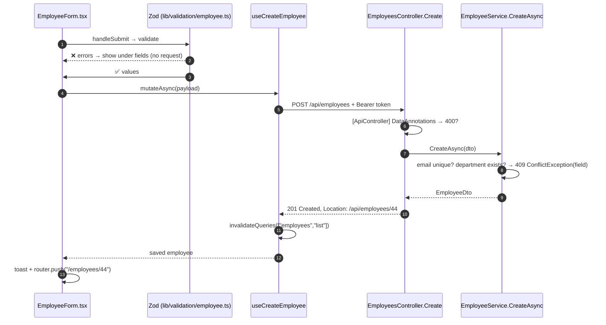

# 11. CRUD end to end

<div class="learn">

**What you'll learn**
- Follow **Create, Read, Update, Delete** from a click in the browser through every file down to SQL Server and back
- Which file to open when something in that chain breaks

<p class="meta">⏱ 30 minutes · Keep VS Code open; every step names a real file</p>
</div>

## Read: the employee list


```mermaid
sequenceDiagram
  autonumber
  participant U as Browser URL<br/>/employees?search=ali&page=2
  participant V as EmployeesView.tsx
  participant H as useEmployeeList (hooks/useEmployees.ts)
  participant A as employeesApi.list → apiFetch (lib/api)
  participant C as EmployeesController.GetAll
  participant S as EmployeeService.GetPagedAsync
  participant D as SQL Server
  U->>V: useSearchParams() → readQuery()
  V->>H: useEmployeeList({ search:"ali", page:2, … })
  H->>H: cache hit for this key? return it
  H->>A: queryFn({ signal })
  A->>C: GET /api/employees?search=ali&page=2&pageSize=10&sortBy=name&sortDir=asc
  C->>S: [FromQuery] EmployeeQuery
  S->>D: SELECT COUNT(*) … ; SELECT … ORDER BY … OFFSET 10 ROWS FETCH NEXT 10
  D-->>S: rows
  S-->>C: PagedResult<EmployeeDto>
  C-->>A: 200 JSON
  A-->>H: PagedResult<Employee>
  H-->>V: { data, isPending:false }
  V->>U: render EmployeeTable + Pagination
```

| Step | File | Look for |
| --- | --- | --- |
| URL → query object | `components/employees/EmployeesView.tsx` | `readQuery()` |
| caching | `hooks/useEmployees.ts` | `employeeKeys.list(query)` |
| HTTP | `lib/api/client.ts` | `buildUrl`, `apiFetch` |
| endpoint | `Controllers/EmployeesController.cs` | `GetAll([FromQuery] EmployeeQuery query)` |
| filtering/sorting/paging | `Services/EmployeeService.cs` | `GetPagedAsync` |
| SQL | API console (EF logs every command in Development) | `OFFSET … FETCH` |

::: tip See the generated SQL
`appsettings.Development.json` sets `Microsoft.EntityFrameworkCore.Database.Command` to `Information`, so every query EF sends to SQL Server is printed in the API terminal.
:::

## Create




## Update (with concurrency)

1. `app/employees/[id]/edit/page.tsx` awaits `params` → `<EditEmployee id={42} />`.
2. `EditEmployee` loads it with `useEmployee(42)` and renders `<EmployeeForm key={rowVersion} employee={…} />`.
3. Submit → `useUpdateEmployee(42).mutateAsync({ ...values, rowVersion })` → `PUT /api/employees/42`.
4. `EmployeeService.UpdateAsync` sets the **original** `RowVersion`; `SaveChangesAsync` issues `UPDATE … WHERE Id=@id AND RowVersion=@v`.
5. ✅ 200 → `setQueryData(detail)` + invalidate lists → navigate to details.
   ❌ 409 → banner *"This employee was changed by someone else"* → **Reload latest version** → `refetch()` → new `key` → fresh form.


## Delete


1. **Delete** sets `toDelete` state → `<ConfirmDialog open>`.
2. **Confirm** → `useDeleteEmployee().mutate(id)`:
   - `onMutate` removes the row from every cached list page (optimistic)
   - `DELETE /api/employees/7` → **204**
   - `onError` restores the snapshot, or `onSettled` refetches
3. Toast *"Aisha Patel was deleted."*

## The same CRUD, server-side (departments)

| Operation | Browser | Next.js server | .NET API |
| --- | --- | --- | --- |
| List | receives HTML/RSC stream | `DepartmentTable` awaits `departmentsApi.list()` | `GET /api/departments` |
| Create | `<form action={formAction}>` posts FormData | `createDepartment` validates (Zod), reads cookie token | `POST /api/departments` |
| Update | same form, `updateDepartment.bind(null, id)` | `updateDepartment` | `PUT /api/departments/{id}` |
| Delete | `startTransition(() => deleteDepartment(id))` | `deleteDepartment` → `revalidatePath` | `DELETE …` → 204 or **409** |


Try deleting **Engineering**: the API refuses with 409 *"'Engineering' still has N employee(s)…"*, the Server Action returns `{ ok: false, message }`, and the button shows it as a toast.

## Debugging the chain

| Symptom | Open first |
| --- | --- |
| Nothing happens on submit | browser Console (JS error?) → is `handleSubmit` getting invalid data? (check `errors`) |
| Request never leaves | Network tab empty → Zod rejected it, or the button is disabled |
| Request is red | Network → Response tab → ProblemDetails `detail` / `errors` |
| CORS error | API console → [chapter 9](./09-integrating-backend-apis#fixing-cors-errors) |
| 200 but UI not updated | TanStack devtools → was the query invalidated? / Server Action → `revalidatePath` called? |
| SQL wrong | API console EF logs |

## Recap

Every CRUD operation crosses the same layers: **component → hook/action → API module → `apiFetch` → controller → service → EF Core → SQL**, and errors come back as ProblemDetails that each layer knows how to show.

## Try it yourself

Add an **"Active only"** quick toggle button above the employees table.

::: details Solution
In `EmployeeFilters.tsx`:
```tsx
<Button variant={query.isActive ? "primary" : "secondary"}
        onClick={() => onChange({ isActive: query.isActive ? undefined : true })}>
  Active only
</Button>
```
The URL changes → the query key changes → TanStack Query fetches `?isActive=true` → the API filters in `GetPagedAsync`. No other code needed.
:::

[Next: State management →](./12-state-management)
