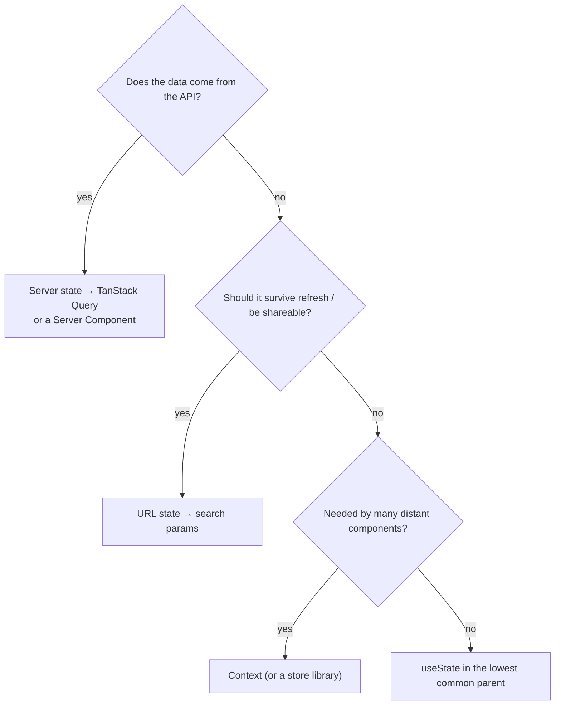

# 12. State management

<div class="learn">

**What you'll learn**
- The five kinds of state in a React app, and where each belongs
- Lifting state up, React Context, server-cache state and URL state
- Why this demo needs **no** Redux/Zustand

<p class="meta">⏱ 30 minutes</p>
</div>

## Five kinds of state

| Kind | Example in the demo | Where it lives | Tool |
| --- | --- | --- | --- |
| **Local UI state** | is the confirm dialog open? search box text | one component | `useState` |
| **Shared UI state** | which employee is being deleted (table → dialog) | nearest common parent | lifting state up |
| **App-wide state** | the logged-in user | a Provider at the top | **Context** |
| **Server state** | employee lists, details, departments | a cache that mirrors the API | **TanStack Query** / Server Components |
| **URL state** | search, filters, sort, page | the address bar | `useSearchParams` + `router.replace` |
| **Form state** | field values, errors, dirty | the form | React Hook Form / `useActionState` |



::: info 🟣 Coming from .NET
- Server state ≈ data you'd load in the controller per request, but **cached** on the client.
- Context ≈ a **scoped service** available to everything below the provider.
- URL state ≈ query-string model binding.
- Local state ≈ private fields of a view model.
:::

## Lifting state up

`EmployeeTable` must not own "which row is being deleted", because the `ConfirmDialog` (a sibling) needs it too. So the parent `EmployeesView` owns it:

```tsx
// parent
const [toDelete, setToDelete] = useState<Employee | null>(null);
<EmployeeTable onDelete={setToDelete} />              // child reports up via callback
<ConfirmDialog open={toDelete !== null} onCancel={() => setToDelete(null)} … />
```

## Context {#context}

Context makes a value available to every component below a Provider, without passing props through each level ("prop drilling").

```tsx
// src/context/AuthContext.tsx (abridged)
const AuthContext = createContext<AuthContextValue | null>(null);

export function AuthProvider({ children }: { children: React.ReactNode }) {
  const token = useSyncExternalStore(subscribeToSession, () => readCookie(TOKEN_COOKIE), () => null);
  const rawUser = useSyncExternalStore(subscribeToSession, () => readCookie(USER_COOKIE), () => null);
  const user = useMemo(() => parseUser(rawUser), [rawUser]);

  const login = useCallback(async (username: string, password: string) => {
    const response = await authApi.login({ username, password });
    saveSession(response);      // writes cookies + notifies subscribers
    router.refresh();
  }, [router]);

  const value = useMemo(() => ({ user, token, isAuthenticated: !!token, login, logout }),
                        [user, token, login, logout]);
  return <AuthContext.Provider value={value}>{children}</AuthContext.Provider>;
}

export function useAuth() {
  const ctx = useContext(AuthContext);
  if (!ctx) throw new Error("useAuth must be used inside <AuthProvider>");
  return ctx;
}
```

Consumers anywhere:

```tsx
const { user, logout } = useAuth();                     // Navbar
const { isAuthenticated } = useAuth();                  // AuthOnly → hides Edit/Delete buttons
const { token } = useAuth();                            // mutations → Authorization header
```

::: tip `useMemo` on the value
Every component using a Context re-renders when its `value` changes identity. Memoising the value object (and the functions with `useCallback`) avoids needless re-renders.
:::

::: warning Don't put server data in Context
It's tempting to load "all employees" into a Context. You'd then have to reinvent caching, loading flags, refetching and invalidation. That's exactly what TanStack Query already does.
:::

## Server state: let the cache own it

Two components can call `useEmployee(42)` and only **one** request is made: the query key de-duplicates. After `useUpdateEmployee` succeeds, `setQueryData(employeeKeys.detail(42), updated)` updates **every** component showing that employee.

On the server side, Server Components simply fetch per request; `revalidatePath` re-renders them after a Server Action.

## URL state

Covered in [chapter 9](./09-integrating-backend-apis#state-in-the-url-search-filters-sorting-paging). Rule of thumb: if a user might want to **bookmark, share or refresh** it, put it in the URL.

## Do I need Redux / Zustand?

Usually not, for CRUD apps. Reach for a store library when you have **complex client-only state shared across many screens** (a drawing tool, a multi-step wizard with undo, a real-time dashboard). For server data, TanStack Query is the better fit.

## Recap

- Put state in the **lowest** place that works; lift it up when siblings need it.
- Context for app-wide values (user, theme), with a custom `useXxx()` hook.
- Server data → TanStack Query or Server Components, never hand-rolled global state.
- Shareable view state → the URL.

## Try it yourself

Show "Hello, admin" on the dashboard when logged in, without passing any props.

::: details Solution
Create a tiny Client Component and drop it into `app/page.tsx`:
```tsx
"use client";
import { useAuth } from "@/context/AuthContext";
export function Greeting() {
  const { user } = useAuth();
  return user ? <p className="mb-4">Hello, {user.username} 👋</p> : null;
}
```
:::

[Next: Authentication (JWT) →](./13-authentication)
