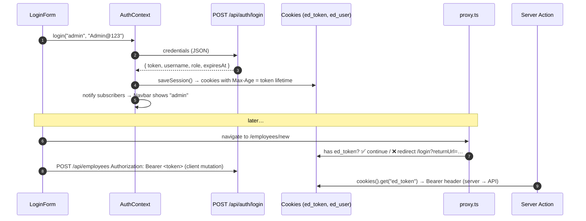

# 13. Authentication (JWT)

<div class="learn">

**What you'll learn**
- The full login flow: .NET issues a JWT, Next.js stores and sends it
- Protecting **API endpoints** (`[Authorize]`) and **pages** (`proxy.ts`)
- Handling expired sessions (401) globally
- Token storage options and their security trade-offs

<p class="meta">⏱ 40 minutes · Files: <code>AuthController.cs</code>, <code>AuthService.cs</code>, <code>lib/auth/*</code>, <code>AuthContext.tsx</code>, <code>proxy.ts</code></p>
</div>

## The flow



## Backend: issuing and validating the token

```csharp
// Services/AuthService.cs (abridged)
var claims = new[]
{
    new Claim(JwtRegisteredClaimNames.Sub, user.Username),
    new Claim(ClaimTypes.Name, user.Username),
    new Claim(ClaimTypes.Role, user.Role),
};
var credentials = new SigningCredentials(
    new SymmetricSecurityKey(Encoding.UTF8.GetBytes(_jwt.Key)), SecurityAlgorithms.HmacSha256);
var token = new JwtSecurityToken(_jwt.Issuer, _jwt.Audience, claims,
    expires: DateTime.UtcNow.AddMinutes(_jwt.ExpiryMinutes), signingCredentials: credentials);
```

```csharp
// Controllers: everything requires a token unless marked otherwise
[Authorize]
public class EmployeesController : ControllerBase
{
    [HttpGet, AllowAnonymous] public … GetAll(…)
    [HttpPost]                public … Create(…)   // 401 without a valid token
}
```

::: danger The signing key is a secret
`appsettings.json` contains a **development-only** key. In production set `Jwt__Key` as an environment variable (or a vault), at least 32 random characters. `appsettings.Production.json` deliberately has a placeholder. Demo users in config are for the demo only; use ASP.NET Core Identity or an identity provider (Entra ID, Auth0, Keycloak…) in real systems.
:::

## Frontend: storing the session

```ts
// src/lib/auth/session.ts (abridged)
export const TOKEN_COOKIE = "ed_token";
export const USER_COOKIE = "ed_user";

export function saveSession(login: LoginResponse) {
  const maxAge = Math.floor((new Date(login.expiresAt).getTime() - Date.now()) / 1000);
  writeCookie(TOKEN_COOKIE, login.token, maxAge);
  writeCookie(USER_COOKIE, JSON.stringify({ username: login.username, role: login.role }), maxAge);
  notify();   // re-render components using the session
}
```

**Why a cookie?** One storage that every part of the app can read:

| Reader | How |
| --- | --- |
| Client Components (mutations) | `document.cookie` via `useAuth().token` |
| Server Components / Server Actions | `cookies()` from `next/headers` (`lib/auth/server.ts`) |
| `proxy.ts` (before a page renders) | `request.cookies.has("ed_token")` |

### Token storage trade-offs

| Option | XSS can steal it? | CSRF risk | Server can read? | Notes |
| --- | --- | --- | --- | --- |
| `localStorage` | ✅ yes | no | ❌ | simplest SPA approach |
| JS-readable cookie **(this demo)** | ✅ yes | low (`SameSite=Lax`, Bearer header still required) | ✅ | works for client + server code |
| **httpOnly** cookie + BFF proxy | ❌ no | needs `SameSite`/anti-forgery | ✅ | recommended for production |

::: warning Production upgrade path
For production, make the token **httpOnly** (JavaScript can't read it), so an XSS bug can't steal it:
1. Do the login in a **Server Action** and set the cookie with `cookies().set(name, token, { httpOnly: true, secure: true, sameSite: "lax" })`.
2. Make client-side API calls go through the Next.js server (a Route Handler proxy or Server Actions) that adds the `Authorization` header from the cookie.
3. Or use a library such as Auth.js / an OIDC provider with the Backend-for-Frontend pattern.

The demo keeps the token JS-readable so the client-side TanStack Query examples stay simple.
:::

## Reading the session in React

```tsx
// AuthContext: useSyncExternalStore reads document.cookie and re-renders when it changes.
const token = useSyncExternalStore(subscribeToSession, () => readCookie(TOKEN_COOKIE), () => null);
```

The third argument (`() => null`) is the **server snapshot**: during server rendering there's no `document`, so the HTML is rendered "logged out" and the browser corrects it after hydration.

UI helpers:

```tsx
// show only to logged-in users (components/auth/AuthOnly.tsx)
<AuthOnly>
  <LinkButton href="/employees/new">+ Add employee</LinkButton>
</AuthOnly>
```

::: danger Hiding buttons is not security
`AuthOnly` and `proxy.ts` improve UX. **The API's `[Authorize]` is what actually protects data.** Try it: `curl -X DELETE http://localhost:5080/api/employees/1` returns 401.
:::

## Protecting pages with `proxy.ts` {#protecting-pages-with-proxy-ts}

```ts
// src/proxy.ts (Next.js 16 name for middleware)
export function proxy(request: NextRequest) {
  if (request.cookies.has(TOKEN_COOKIE)) return NextResponse.next();

  const loginUrl = new URL("/login", request.url);
  loginUrl.searchParams.set("returnUrl", request.nextUrl.pathname);
  return NextResponse.redirect(loginUrl);
}

export const config = {
  matcher: ["/employees/new", "/employees/:id/edit", "/departments/new", "/departments/:id/edit"],
};
```

::: info 🟣 Coming from .NET
`proxy.ts` ≈ an ASP.NET Core middleware with a path filter, or `[Authorize]` + the cookie auth `LoginPath` redirect. `returnUrl` works just like `ReturnUrl` in ASP.NET Identity.
:::

The login form only accepts **local** return URLs to prevent open redirects:

```ts
function safeReturnUrl(value: string | null): string {
  return value && value.startsWith("/") && !value.startsWith("//") ? value : "/";
}
```

## Expired sessions: one global handler

The JWT expires after `Jwt:ExpiryMinutes` (120). When any mutation gets **401**:

```ts
// providers.tsx: TanStack Query's MutationCache
onError: (error) => {
  if (error instanceof ApiError && error.status === 401) signalUnauthorized(); // dispatches a window event
}

// AuthContext.tsx: listens and reacts
useEffect(() => {
  function handleUnauthorized() {
    clearSession();
    toast.error("Your session has expired. Please log in again.");
    router.push("/login?returnUrl=" + encodeURIComponent(window.location.pathname));
  }
  window.addEventListener(UNAUTHORIZED_EVENT, handleUnauthorized);
  return () => window.removeEventListener(UNAUTHORIZED_EVENT, handleUnauthorized);
}, [router]);
```

Why an event? The `QueryClient` lives outside React and can't use the router; the event hands the job to a component that can.

## Roles

The token carries a `role` claim. To restrict an endpoint: `[Authorize(Roles = "Admin")]`. To restrict UI: `useAuth().user?.role === "Admin"`. Add more demo users in `appsettings.json` → `DemoUsers`.

## Recap

- .NET issues a signed JWT; every write sends `Authorization: Bearer …`.
- The demo stores the token in a cookie readable by client code, server code and `proxy.ts`.
- `proxy.ts` redirects anonymous users from protected pages; `[Authorize]` is the real guard.
- 401 → global handler → login page with `returnUrl`.

## Try it yourself

Add a second user `viewer / Viewer@123` with role `Viewer` who may log in but not delete.

::: details Solution
1. `appsettings.json` → add to `DemoUsers`: `{ "Username": "viewer", "Password": "Viewer@123", "Role": "Viewer" }`.
2. `EmployeesController.Delete` → `[Authorize(Roles = "Admin")]` → 403 for viewers.
3. UI: in `EmployeeTable`, render Delete only when `useAuth().user?.role === "Admin"`.
:::

[Next: Styling with Tailwind →](./14-styling-with-tailwind)
