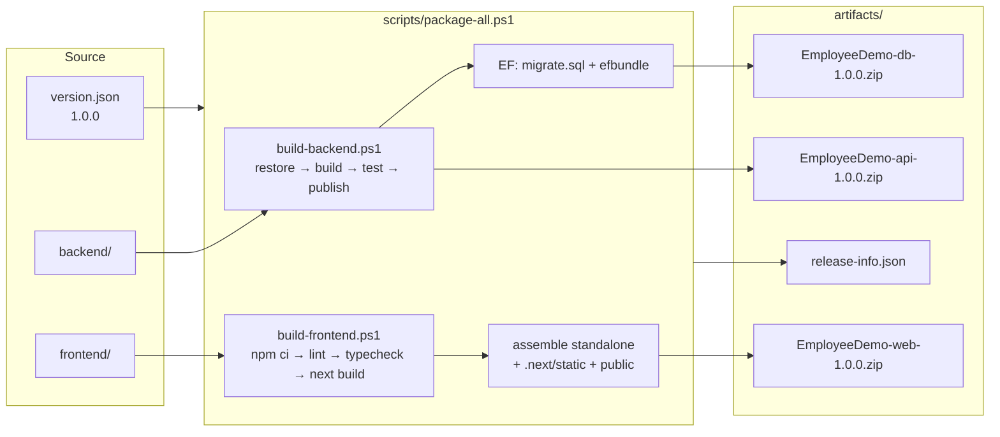

# 16. Build & package a release

<div class="learn">

**What you'll learn**
- Development build vs production build, and what ends up in `.next/`
- Next.js output modes: default, **standalone** (used here), static export
- Environment variables per environment: build-time vs runtime
- .NET publish modes: framework-dependent, self-contained, RID-specific, portable
- Shipping **database changes** safely: idempotent SQL script vs migration bundle
- One command that produces **versioned release zips**, plus the CI pipeline that runs it

<p class="meta">⏱ 45 minutes · Files: <code>scripts/*.ps1</code>, <code>version.json</code>, <code>frontend/next.config.ts</code>, <code>.github/workflows/build.yml</code></p>
</div>

## The pipeline



## TL;DR: make a release

```powershell
# from the repository root
./scripts/package-all.ps1 -ApiBaseUrl https://api.mycompany.com
```

Real output from this repo:

```txt
==> Packaging Employee Demo 1.0.0
==> Restore local tools (dotnet-ef)
==> Restore NuGet packages
==> Build (Release)
==> Run tests                                   Passed! - Failed: 0, Passed: 10
==> Publish API (framework-dependent, win-x64) → artifacts\api
==> Generate idempotent SQL migration script
==> Create EF Core migration bundle (win-x64)
==> Install packages (npm ci)
==> Lint (ESLint)
==> Type-check (tsc)
==> Build Next.js (API: http://localhost:5080)
==> Assemble standalone app → artifacts\web
==> Create zip files
  EmployeeDemo-api-1.0.0.zip              7.3 MB
  EmployeeDemo-web-1.0.0.zip              5.5 MB
  EmployeeDemo-db-1.0.0.zip              16.8 MB
==> Done → artifacts
```

| Parameter | Default | Meaning |
| --- | --- | --- |
| `-ApiBaseUrl` | `http://localhost:5080` | API URL **baked into the browser bundle** |
| `-Runtime` | `win-x64` | target OS/CPU for the API (`linux-x64` for Linux/containers) |
| `-SelfContained` | off | include the .NET runtime in the API package |
| `-SkipTests` | off | skip `dotnet test` (not recommended) |

## Part 1: the Next.js build

### Dev build vs production build

| | `npm run dev` | `npm run build` + `npm start` |
| --- | --- | --- |
| Compiles | on demand, per page you open | everything, ahead of time |
| Code | unminified, source maps, Fast Refresh | minified, tree-shaken, hashed file names |
| Checks | none up front | **TypeScript type-check** + prerender of every route |
| Errors | dev overlay | build fails (good: you find problems before users do) |
| Output | `.next/dev/` | `.next/` (+ `.next/standalone/`) |

### Reading the build output

```txt
Route (app)
┌ ◐ /
├ ○ /_not-found
├ ◐ /departments
├   /departments/[id]/edit
│ └ ◐ /departments/[id]/edit
├ ○ /departments/new
├ ○ /employees
├   /employees/[id]
│ └ ◐ /employees/[id]
├ ○ /employees/new
└ ○ /login

ƒ Proxy (Middleware)

○  (Static)             prerendered as static content
◐  (Partial Prerender)  prerendered as static HTML with dynamic server-streamed content
```

- **○ Static**: the whole page is HTML generated at build time (client components then fetch data in the browser, e.g. `/employees`).
- **◐ Partial Prerender**: a static shell (layout, headers, `<Suspense>` fallbacks) is ready at build time, and the dynamic parts (API data, cookies, params) stream in per request.
- **ƒ Proxy**: `proxy.ts` runs on every matching request.

### Output modes

| `output` in next.config.ts | Produces | Server needs | Supports Server Components / Actions / `proxy.ts` |
| --- | --- | --- | --- |
| *(default)* | `.next/` | Node.js **+ full `node_modules`** + `next start` | ✅ |
| **`"standalone"`** (this demo) | `.next/standalone/` with `server.js` and only the needed `node_modules` | **Node.js only** | ✅ |
| `"export"` | plain HTML/CSS/JS in `out/` | any static host (IIS static site, S3, CDN) | ❌ no Server Actions, no `proxy.ts`, no request-time rendering |

::: info 🟣 Coming from .NET
`standalone` is the closest to `dotnet publish`: a folder with everything needed to run, minus the runtime (Node.js ≈ the .NET runtime). `output: "export"` is like publishing a static `wwwroot` only. It would work for a pure client-side SPA, but this demo uses Server Components and Server Actions, so it needs a Node.js server.
:::

### Assembling the standalone folder

`next build` deliberately does **not** copy static assets into `standalone/` (they're meant for a CDN). `build-frontend.ps1` copies them:

```powershell
Copy-Item .next/standalone/*  → artifacts/web/
Copy-Item .next/static        → artifacts/web/.next/static   # JS/CSS chunks
Copy-Item public              → artifacts/web/public         # images, favicon
```

::: warning The #1 production surprise
If the site loads **without CSS or JavaScript** (404s for `/_next/static/...`), the `.next/static` folder wasn't copied next to `server.js`.
:::

Resulting package:

```txt
artifacts/web/                 21.8 MB (5.5 MB zipped)
├── server.js                  ← node server.js
├── package.json
├── .env.production            ← non-secret defaults, overridable by real env vars
├── .next/
│   ├── server/                ← compiled Server Components, actions, proxy
│   └── static/                ← hashed browser assets (copied by the script)
├── node_modules/              ← only what the server actually imports (traced)
└── public/
```

Run it:

```powershell
$env:PORT = "3000"; $env:HOSTNAME = "0.0.0.0"; $env:API_BASE_URL = "http://localhost:5080"
node server.js
```

### Environment variables per environment {#environment-variables-per-environment}

| Variable | Read when | Change per environment by… |
| --- | --- | --- |
| `NEXT_PUBLIC_API_BASE_URL` | **`next build`** (inlined into JS) | building once per environment: `-ApiBaseUrl` |
| `APP_VERSION` → `NEXT_PUBLIC_APP_VERSION` | `next build` | set by the script from `version.json` |
| `API_BASE_URL` | **runtime** (server only) | setting an env var on the server, no rebuild |
| `PORT`, `HOSTNAME` | runtime | env vars for `server.js` |

::: tip "Build once, deploy everywhere"?
If you need one artifact for all environments, avoid `NEXT_PUBLIC_*` for environment-specific values. Options: (1) call the API only from the server (Server Components / Server Actions use the runtime `API_BASE_URL`); (2) a `rewrites` proxy so the browser calls a relative `/api/...`; (3) expose a small runtime config endpoint the client reads at start-up.
:::

Compare with ASP.NET Core: `ASPNETCORE_ENVIRONMENT=Production` selects `appsettings.Production.json`; Next.js uses `NODE_ENV` (`production` for build/start) to select `.env.production`. In both, **real environment variables override files**.

## Part 2: the .NET publish

### Publish modes

| Mode | Command (simplified) | Size here | Server needs |
| --- | --- | --- | --- |
| **Framework-dependent, RID-specific** (default) | `dotnet publish -r win-x64 --self-contained false` | **17.7 MB** | ASP.NET Core Runtime / Hosting Bundle 10 |
| Framework-dependent, portable (`-Portable`) | `dotnet publish` (no `-r`) | 82 MB | same, runs on any OS |
| Self-contained (`-SelfContained`) | `dotnet publish -r win-x64 --self-contained true` | 123 MB | nothing |

Why was portable so big? It ships native SqlClient/MSAL binaries for **every** OS under `runtimes/` (the Linux MSAL library alone is 36 MB). Choosing a **RID** (`win-x64`, `linux-x64`) keeps only one platform.

Other useful settings, already in `EmployeeDemo.Api.csproj`:

```xml
<Version>1.0.0</Version>                                    <!-- overridden by the script -->
<SatelliteResourceLanguages>en</SatelliteResourceLanguages> <!-- drop de/, fr/, ja/... resource folders -->
<IncludeSourceRevisionInInformationalVersion>false</IncludeSourceRevisionInInformationalVersion>
```

| Option | Use when | Caveat |
| --- | --- | --- |
| `PublishSingleFile` | you want one `.exe` | mostly for self-contained apps / tools |
| `PublishReadyToRun` | faster cold start | bigger files |
| `PublishTrimmed` | smallest self-contained size | ⚠ **not supported with EF Core** / reflection-heavy code; avoid for this API |

The script also deletes `appsettings.Development.json` from the package: development settings don't belong on a server.

### What's in `artifacts/api/`

```txt
EmployeeDemo.Api.dll / .exe     ← your app
EmployeeDemo.Api.deps.json      ← dependency graph
EmployeeDemo.Api.runtimeconfig.json
appsettings.json                ← defaults
appsettings.Production.json     ← production overrides (no secrets!)
web.config                      ← generated for IIS (ASP.NET Core Module)
Microsoft.*.dll, Scalar.*.dll   ← NuGet dependencies
runtimes/win-x64/native/…       ← SqlClient native bits for this RID only
```

## Part 3: database changes {#database-changes}

In Development the API runs `Migrate()` at start-up. **Don't do that in production**: the app's account would need DDL rights, several instances could migrate at once, and a DBA can't review the change. The script produces two alternatives:

| Artifact | Command | Use it when |
| --- | --- | --- |
| `db/migrate.sql` | `dotnet ef migrations script --idempotent` | a DBA reviews/runs scripts in SSMS / a pipeline. **Idempotent** = checks `__EFMigrationsHistory` and only applies what's missing, so it's safe to run twice |
| `db/efbundle.exe` | `dotnet ef migrations bundle` | automated deployments: `efbundle.exe --connection "Server=…;Database=…"` |

Verified on this repo: the SQL script created an empty database's tables, and running the bundle afterwards correctly reported nothing to do.

```powershell
sqlcmd -S SQLPROD01 -E -C -d EmployeeDemoDb -i migrate.sql -b
# or
.\efbundle.exe --connection "Server=SQLPROD01;Database=EmployeeDemoDb;Trusted_Connection=True;TrustServerCertificate=True"
```

::: info 🟣 Coming from .NET
This is the same workflow you'd use for any EF Core app. The only new part in this chapter is that the front end is a separate artifact with its own runtime (Node.js).
:::

## Part 4: versioning

- One source of truth: **`version.json`** (`"1.0.0"`).
- The scripts add the git commit when available: `1.0.0+a1b2c3d`.
- .NET: `-p:Version=1.0.0 -p:InformationalVersion=1.0.0+a1b2c3d` → shown by `GET /api/health`:
  ```json
  { "status": "Healthy", "version": "1.0.0", "environment": "Production" }
  ```
- Next.js: `APP_VERSION` → `NEXT_PUBLIC_APP_VERSION` → shown in the footer (`Employee Demo v1.0.0`).
- `artifacts/release-info.json` records what was built:

```json
{
  "product": "EmployeeDemo",
  "version": "1.0.0",
  "informational": "1.0.0",
  "builtAtUtc": "2026-11-08T14:02:06.7667705Z",
  "apiRuntime": "win-x64",
  "apiMode": "framework-dependent",
  "webApiBaseUrl": "http://localhost:5080",
  "files": { "api": "EmployeeDemo-api-1.0.0.zip", "web": "EmployeeDemo-web-1.0.0.zip", "db": "EmployeeDemo-db-1.0.0.zip" }
}
```

To release a new version: bump `version.json` (and `frontend/package.json` `version` for local dev display), commit, run the script / CI.

## Part 5: release checklist

| ✅ | Check | Command / where |
| --- | --- | --- |
| ☐ | Backend tests pass | `dotnet test` (in the script) |
| ☐ | Lint + type-check pass | `npm run lint`, `npm run typecheck` (in the script) |
| ☐ | Production build succeeds (prerender errors surface here) | `npm run build` |
| ☐ | Vulnerable packages reviewed | `npm audit --omit=dev`, `dotnet list package --vulnerable --include-transitive` |
| ☐ | `NEXT_PUBLIC_API_BASE_URL` is the **target** API URL | `-ApiBaseUrl` |
| ☐ | No secrets in packages | `.env*.local` removed by the script; `appsettings.Production.json` has placeholders only |
| ☐ | DB script reviewed / bundle tested on a copy | `migrate.sql` |
| ☐ | CORS allows the production web origin | `Cors__AllowedOrigins__0` |
| ☐ | Smoke test after deploy | [chapter 16b](./16b-deploy-to-iis-and-docker#smoke-test-after-deploying) |

<details>
<summary><b>▶ Deep dive: bundle size and source maps</b></summary>

- `next build` code-splits per route: a page only downloads the JS for the components it uses. Server Components add **zero** JS.
- Heavy client libraries are the usual culprit. Keep them out of Server Components' imports and lazy-load rarely used widgets with `next/dynamic`.
- Browser source maps are off in production by default (`productionBrowserSourceMaps: false`), so your original source isn't public.

</details>

## Part 6: CI {#ci}

`.github/workflows/build.yml` runs **the same script** on every push/PR, with a SQL Server service container for the integration tests, and uploads the zips:

```yaml
jobs:
  build:
    runs-on: ubuntu-latest
    services:
      sql:
        image: mcr.microsoft.com/mssql/server:2022-latest
        env: { ACCEPT_EULA: "Y", MSSQL_SA_PASSWORD: "Ci_Passw0rd!" }
        ports: ["1433:1433"]
    env:
      TEST_CONNECTION_STRING: "Server=localhost,1433;Database=EmployeeDemoDb_Tests;User Id=sa;Password=Ci_Passw0rd!;TrustServerCertificate=True"
    steps:
      - uses: actions/checkout@v4
      - uses: actions/setup-dotnet@v4
        with: { dotnet-version: "10.0.x" }
      - uses: actions/setup-node@v4
        with: { node-version: "24", cache: npm, cache-dependency-path: frontend/package-lock.json }
      - run: ./scripts/package-all.ps1 -Runtime linux-x64 -ApiBaseUrl "${{ vars.API_BASE_URL || 'http://localhost:5080' }}"
        shell: pwsh
      - uses: actions/upload-artifact@v4
        with:
          name: employee-demo-${{ github.sha }}
          path: |
            artifacts/*.zip
            artifacts/release-info.json
```

| GitHub Actions | Azure DevOps Pipelines |
| --- | --- |
| `actions/setup-dotnet` | `UseDotNet@2` |
| `actions/setup-node` | `NodeTool@0` (or `UseNode@1`) |
| `run: ./scripts/package-all.ps1` with `shell: pwsh` | `PowerShell@2` with `pwsh: true` |
| `services: sql:` | `resources.containers` + `services:` |
| `actions/upload-artifact` | `PublishPipelineArtifact@1` |
| `vars.API_BASE_URL` | pipeline variables / variable groups |

::: tip Same script locally and in CI
Keeping the logic in `scripts/*.ps1` (not in YAML) means you can reproduce any CI failure on your machine with one command.
:::

## Recap

- `output: "standalone"` + copying `.next/static` and `public` gives a self-contained Node.js app.
- `NEXT_PUBLIC_*` is baked in at build time, so build per environment (or avoid it).
- Publish the API **RID-specific framework-dependent** for small packages; don't trim EF Core apps.
- Ship DB changes as an idempotent script or a migration bundle, never `Migrate()` on start-up in production.
- `package-all.ps1` = tests + builds + versioned zips, and CI runs exactly that.

[Next: Deploy to IIS & Docker →](./16b-deploy-to-iis-and-docker)
