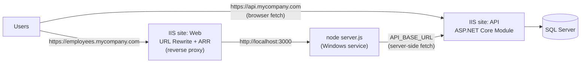

# 16b. Deploy to IIS & Docker

<div class="learn">

**What you'll learn**
- Host the API on **IIS** with the ASP.NET Core Module
- Host the Next.js app on Windows: Node.js as a service + **IIS reverse proxy**
- Run the whole stack with **Docker Compose**
- A smoke test that proves a fresh deployment works

<p class="meta">⏱ 40 minutes · Files: <code>deploy/iis/*</code>, <code>deploy/windows/start-web.ps1</code>, <code>deploy/docker/*</code></p>
</div>

## Target architecture on Windows



::: info 🟣 Coming from .NET
The API part is exactly what you already do for any ASP.NET Core app. The new part is that IIS doesn't execute the Next.js app: **Node.js runs it**, and IIS only forwards requests to it (like a load balancer in front of Kestrel).
:::

## 1. Database

Run `db/migrate.sql` (from `EmployeeDemo-db-1.0.0.zip`) against the target database, or:

```powershell
.\efbundle.exe --connection "Server=SQLPROD01;Database=EmployeeDemoDb;Trusted_Connection=True;TrustServerCertificate=True"
```

The API's app pool identity needs only data rights (`db_datareader`, `db_datawriter`), not DDL rights, because the schema is deployed separately.

## 2. API on IIS

1. Install the **ASP.NET Core Hosting Bundle 10** on the server (adds the ASP.NET Core Module + runtime). Restart IIS (`iisreset`).
2. Unzip `EmployeeDemo-api-1.0.0.zip` to e.g. `C:\apps\employee-api`.
3. IIS Manager → **Application Pools** → *Add* → name `EmployeeDemoApi`, **.NET CLR version: No Managed Code**.
4. **Sites** → *Add Website* → physical path `C:\apps\employee-api`, app pool `EmployeeDemoApi`, binding `https://api.mycompany.com` (with a certificate).
5. Configure environment variables (no secrets in files!). Either in IIS Manager → site → *Configuration Editor* → `system.webServer/aspNetCore` → `environmentVariables`, or in `web.config` (see `deploy/iis/api/web.config.example`):

```xml
<aspNetCore processPath=".\EmployeeDemo.Api.exe" hostingModel="inprocess">
  <environmentVariables>
    <environmentVariable name="ASPNETCORE_ENVIRONMENT" value="Production" />
    <environmentVariable name="ConnectionStrings__DefaultConnection" value="Server=SQLPROD01;Database=EmployeeDemoDb;Trusted_Connection=True;TrustServerCertificate=True" />
    <environmentVariable name="Jwt__Key" value="REPLACE-with-a-long-random-secret-of-32+-chars" />
    <environmentVariable name="Cors__AllowedOrigins__0" value="https://employees.mycompany.com" />
  </environmentVariables>
</aspNetCore>
```

::: tip `__` in variable names
`ConnectionStrings__DefaultConnection` maps to the configuration key `ConnectionStrings:DefaultConnection`. Arrays use indexes: `Cors__AllowedOrigins__0`, `Cors__AllowedOrigins__1`.
:::

6. Browse `https://api.mycompany.com/api/health`, which should show `"environment": "Production"`. (Scalar at `/scalar` is Development-only and returns 404 here, which is intended.)

If you get **500.30 / 500.31**, set `stdoutLogEnabled="true"` temporarily and check `logs\stdout_*.log` (usually a missing Hosting Bundle or a bad connection string).

## 3. Web app on Windows (Node + IIS reverse proxy)

### 3a. Install Node.js and run the app as a service

1. Install **Node.js 24 LTS** on the server.
2. Unzip `EmployeeDemo-web-1.0.0.zip` to `C:\apps\employee-web` (it contains `server.js`).
3. Copy `deploy/windows/start-web.ps1` into that folder and test it:

```powershell
cd C:\apps\employee-web
.\start-web.ps1 -Port 3000 -ApiBaseUrl https://api.mycompany.com
# → ▲ Next.js 16.4.5  - Local: http://localhost:3000
```

4. Make it a Windows service so it starts on boot and restarts on crash. Two common options:

::: code-group

```powershell [NSSM]
# https://nssm.cc — wraps any program as a service
nssm install EmployeeDemoWeb "C:\Program Files\PowerShell\7\pwsh.exe" "-File C:\apps\employee-web\start-web.ps1 -Port 3000 -ApiBaseUrl https://api.mycompany.com"
nssm set EmployeeDemoWeb AppDirectory C:\apps\employee-web
nssm start EmployeeDemoWeb
```

```powershell [PM2]
# Node process manager
npm install -g pm2 pm2-windows-startup
pm2-startup install
$env:PORT=3000; $env:API_BASE_URL="https://api.mycompany.com"
pm2 start C:\apps\employee-web\server.js --name employee-web
pm2 save
```

:::

### 3b. IIS site as reverse proxy

1. Install IIS modules **URL Rewrite** and **Application Request Routing (ARR)**.
2. IIS Manager → server node → *Application Request Routing Cache* → *Server Proxy Settings* → ✅ **Enable proxy**.
3. Create an empty folder `C:\apps\employee-web-proxy`, copy `deploy/iis/web/web.config` into it:

```xml
<rewrite>
  <rules>
    <rule name="ReverseProxyToNext" stopProcessing="true">
      <match url="(.*)" />
      <action type="Rewrite" url="http://localhost:3000/{R:1}" />
    </rule>
  </rules>
</rewrite>
```

4. Add a website with that folder, binding `https://employees.mycompany.com`.

::: warning Remember the build-time API URL
The web package must be built with `-ApiBaseUrl https://api.mycompany.com`. Otherwise the browser will call `http://localhost:5080`. And the API's CORS must allow `https://employees.mycompany.com`.
:::

<details>
<summary><b>▶ Alternatives: iisnode, Azure App Service, Linux</b></summary>

- **iisnode** (running Node inside IIS) is unmaintained. Prefer the reverse-proxy setup above.
- **Azure App Service**: deploy the API to a .NET App Service and the web zip to a Node App Service (startup command `node server.js`).
- **Linux**: run `node server.js` under systemd behind nginx; publish the API with `-Runtime linux-x64` and run it behind nginx too, or use the Docker setup below.

</details>

## 4. Docker Compose

`deploy/docker/` contains multi-stage Dockerfiles and a compose file with SQL Server, the API and the web app:

```powershell
cd deploy/docker
docker compose up --build
# web → http://localhost:3000    api → http://localhost:5080    sql → localhost,14333
docker compose down -v           # stop and delete the database volume
```

Key points of `docker-compose.yml`:

```yaml
api:
  environment:
    ConnectionStrings__DefaultConnection: "Server=sql,1433;Database=EmployeeDemoDb;User Id=sa;Password=Demo_Passw0rd!;TrustServerCertificate=True"
    Cors__AllowedOrigins__0: "http://localhost:3000"
    Database__MigrateOnStartup: "true"     # demo convenience only
  ports: ["5080:8080"]

web:
  build:
    args:
      NEXT_PUBLIC_API_BASE_URL: "http://localhost:5080"   # the BROWSER uses the published port
  environment:
    API_BASE_URL: "http://api:8080"                        # the Next.js SERVER uses the Docker network
```

This is the clearest illustration of the two API URLs: the **browser** is outside Docker and reaches the API through `localhost:5080`, while the **Next.js server** is inside the Docker network and reaches it as `api:8080`.

| Image | Base | Why multi-stage |
| --- | --- | --- |
| API | `dotnet/sdk:10.0` → `dotnet/aspnet:10.0` | the SDK (~900 MB) is only needed to compile |
| Web | `node:24-alpine` ×3 (deps → build → runtime) | runtime image contains only `standalone` + static files |

::: warning Not verified on this machine
Docker Desktop wasn't running when this guide was written, so `docker compose up` was **not executed** as part of the verification. The Dockerfiles follow the official .NET and Next.js patterns; please run it once and report issues.
:::

## Smoke test after deploying {#smoke-test-after-deploying}

```powershell
$api = "https://api.mycompany.com"; $web = "https://employees.mycompany.com"

Invoke-RestMethod "$api/api/health"                         # status Healthy, version, Production
(Invoke-WebRequest "$web/" -UseBasicParsing).StatusCode    # 200
$html = (Invoke-WebRequest "$web/" -UseBasicParsing).Content
$css = [regex]::Match($html, '/_next/static/[^"]+\.css').Value
(Invoke-WebRequest "$web$css" -UseBasicParsing).StatusCode # 200 → static assets were deployed
(Invoke-WebRequest "$api/scalar" -SkipHttpErrorCheck).StatusCode  # 404 → dev tools are off
```

Then in a browser: log in, create an employee, edit, delete. The same checks were run against the packaged release of this demo (API in Production mode on a fresh database created from `migrate.sql`, web via `node server.js`), and **all 21 end-to-end checks passed**.

## Recap

- API: Hosting Bundle + "No Managed Code" app pool + env vars for secrets.
- Web: Node.js runs `server.js` as a service; IIS (URL Rewrite + ARR) proxies to it.
- Docker: two API URLs, one for the browser, one for the server-side code.
- Always smoke-test health, static assets and a full CRUD round trip.

[Next: Troubleshooting & FAQ →](./17-troubleshooting-faq)
