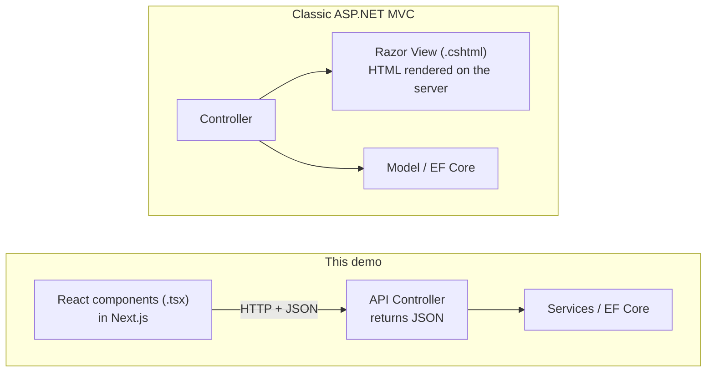

# Welcome 👋

This guide is for a developer who is **productive with SQL Server, ASP.NET Core, MVC and message queues**, but has **never built a React front end**. By the end you will understand, and be able to rebuild from scratch, the demo application in this repository:

- an **ASP.NET Core 10 Web API** with EF Core, SQL Server, validation, ProblemDetails errors, JWT auth and integration tests
- a **Next.js 16 / React 19 / TypeScript** front end with lists, search, paging, forms, validation, login, optimistic updates and error handling
- **release packaging**: versioned zips, database scripts, IIS and Docker deployment, CI

<div class="learn">

**How this guide is written**

- 🟣 Purple **"Coming from .NET"** boxes map each new idea to something you already know.
- 💡 Green **tips**, 🟡 yellow **warnings** (common mistakes), 🔴 red **danger** boxes (security).
- ▶ Collapsible **"Deep dive"** sections can be skipped on a first read.
- Every chapter starts with *What you'll learn* and ends with a **Recap** and a small **exercise**.
- All code snippets are copied from the real files in this repo. Open them side by side in VS Code.

</div>

## The mental model in one picture

If you remember only one thing, remember this: **React replaces your Razor views. The .NET API stays the backend.**



| You know (MVC) | In this demo |
| --- | --- |
| `Controller` returning `View()` | `ApiController` returning JSON + a React **page** that renders it |
| `.cshtml` Razor view | `.tsx` React **component** |
| `_Layout.cshtml` | `app/layout.tsx` |
| Partial view / View Component | a reusable component in `src/components/` |
| `@Model.Name` | `{employee.name}` inside JSX |
| `ModelState` + DataAnnotations | Zod schema in the browser **and** DataAnnotations in the API |
| Route `/{controller}/{action}/{id}` | folders: `app/employees/[id]/page.tsx` → `/employees/42` |
| NuGet + `.csproj` | npm + `package.json` |
| `dotnet run` / `dotnet publish` | `npm run dev` / `npm run build` |

## Learning path

Follow the chapters in order the first time. Each one builds on the previous.

| # | Chapter | You'll be able to… | ⏱ |
| --- | --- | --- | --- |
| 1 | [Prerequisites & tooling](./01-prerequisites-and-tooling) | install Node.js, set up VS Code, open the browser dev tools | 20 min |
| 2 | [JavaScript & TypeScript essentials](./02-javascript-typescript-essentials) | read modern JS/TS syntax (arrow functions, destructuring, async) | 45 min |
| 3 | [React fundamentals](./03-react-fundamentals) | write components with props, state, events, lists, effects | 60 min |
| 4 | [Create a Next.js project from zero](./04-create-nextjs-project-from-zero) | scaffold, run and extend a new project | 30 min |
| 5 | [Project structure & every file](./05-project-structure-and-files) | explain what each generated file and file type does | 30 min |
| 6 | [npm & package.json](./06-package-management) | add, update and audit packages; understand the lock file | 25 min |
| 7 | [Routing & rendering](./07-routing-and-rendering) | create pages, layouts, dynamic routes; choose Server vs Client Components | 60 min |
| 8 | [The .NET API walkthrough](./08-backend-api-walkthrough) | build the API: EF Core, DTOs, CORS, ProblemDetails, OpenAPI, JWT | 45 min |
| 9 | [Calling the backend API](./09-integrating-backend-apis) | write a typed API client, use env vars, TanStack Query, handle errors | 60 min |
| 10 | [Forms & validation](./10-forms-and-validation) | build forms 3 ways, map server validation errors to fields | 45 min |
| 11 | [CRUD end to end](./11-crud-end-to-end) | trace a click all the way to SQL and back | 30 min |
| 12 | [State management](./12-state-management) | pick the right place for each piece of state | 30 min |
| 13 | [Authentication (JWT)](./13-authentication) | log in, protect pages and endpoints, understand token storage trade-offs | 40 min |
| 14 | [Styling with Tailwind](./14-styling-with-tailwind) | read and write Tailwind classes, make reusable UI | 25 min |
| 15 | [Debugging](./15-debugging) | debug the API and React together with breakpoints | 25 min |
| 16 | [Build & package a release](./16-build-and-package) | produce versioned release zips and DB scripts | 45 min |
| 16b | [Deploy to IIS & Docker](./16b-deploy-to-iis-and-docker) | host the packages on Windows/IIS or in containers | 40 min |
| 17 | [Troubleshooting & FAQ](./17-troubleshooting-faq) | fix the errors everybody hits | as needed |
| 18 | [Glossary](./18-glossary) | look up any React/Next term with its .NET equivalent | as needed |

## Run the finished demo {#run-the-finished-demo}

You need **.NET SDK 10**, **Node.js 22+** (24 recommended) and a **SQL Server** you can reach with Windows authentication on `localhost` (Developer/Express/LocalDB all work; see [chapter 1](./01-prerequisites-and-tooling)).

::: code-group

```powershell [1️⃣ API (terminal 1)]
cd backend
dotnet tool restore            # installs dotnet-ef from dotnet-tools.json
dotnet run --project src/EmployeeDemo.Api
# → http://localhost:5080/scalar  (database is created + seeded on first run)
```

```powershell [2️⃣ Web (terminal 2)]
cd frontend
npm install
npm run dev
# → http://localhost:3000
```

```powershell [3️⃣ This guide (optional)]
cd docs
npm install
npm run docs:dev
# → http://localhost:5173
```

:::

Log in with **admin / Admin@123** to create, edit and delete. Reading is public.

::: tip Using a different SQL Server?
Change `ConnectionStrings:DefaultConnection` in `backend/src/EmployeeDemo.Api/appsettings.json`, e.g. `Server=(localdb)\MSSQLLocalDB;Database=EmployeeDemoDb;Trusted_Connection=True;TrustServerCertificate=True`.
:::

## Repository map

<FileTree name="repo" title="Repository root" />

## What the demo covers

<details>
<summary><b>Full feature checklist</b> (click to expand)</summary>

**Reading data**
- Server-rendered dashboard with streaming (`<Suspense>`)
- Client-side list with debounced search, filters, sorting, paging, all kept in the URL
- Details page with a dynamic route `[id]`, 404 handling
- Loading skeletons/spinners, empty states, error boundaries with retry

**Writing data**
- Create + edit with one shared form (React Hook Form + Zod)
- Server-side validation errors (HTTP 400) mapped to form fields
- Duplicate email / code (HTTP 409) mapped to form fields
- Optimistic concurrency with SQL `rowversion` (HTTP 409 + "reload latest" button)
- Delete with a confirm dialog, optimistic removal and rollback on failure
- Server Actions with `useActionState` (departments)
- Business-rule conflict: deleting a department that still has employees

**Cross-cutting**
- JWT login, protected pages (`proxy.ts`), protected endpoints (`[Authorize]`)
- Global 401 handling, toasts, React Context for the current user
- Environment variables per environment, CORS
- Integration tests (xUnit + WebApplicationFactory), lint, type-check
- Versioned release packaging, IIS, Docker, CI

</details>

**Ready?** Start with [Chapter 1: Prerequisites & tooling →](./01-prerequisites-and-tooling)
